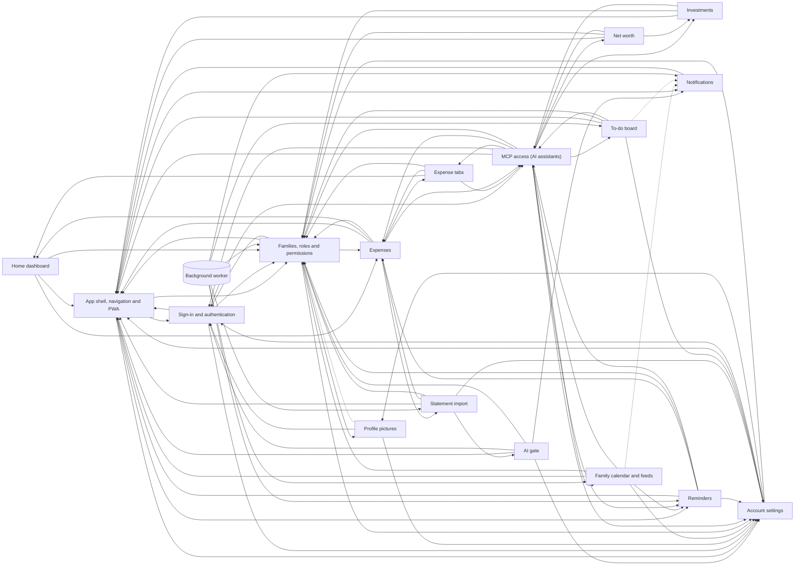

# Feature map

_Generated by `npm run feature-map` (`.claude/skills/feature-map`). Do not edit by hand: change `.claude/skills/feature-map/features.json` or the scripts and run it again._

The app has **17 features** plus 4 shared infrastructure areas, built from 843 source files: 23 pages, 69 route handlers, 30 tables, 93 SQL functions, 70 RLS policies, 38 migrations, 32 MCP tools and 7 worker jobs. Tests: 6,591 cases in 264 files. Unassigned items: **2**.

Unit, route, component and page test cases come from `vitest list` (each it.each row counts); a database test file counts its pgTAP `plan(n)`. "Depends on" means the feature's code or SQL uses the other one: imports, calls its API routes, reads its tables or calls its SQL functions, or (for the worker) runs a job over its data.

## Features

| Feature | Pages | Routes | Tables | MCP tools | Worker jobs | Test cases | Depends on |
| --- | --- | --- | --- | --- | --- | --- | --- |
| [Home dashboard](#dashboard) | 1 | 1 | 0 | 0 | 0 | 14 | App shell, navigation and PWA, Design system (UI kit), Expenses, Families, roles and permissions, Platform and shared plumbing |
| [Expenses](#expenses) | 1 | 3 | 3 | 5 | 0 | 205 | App shell, navigation and PWA, Home dashboard, Design system (UI kit), Expense tabs, Families, roles and permissions, MCP access (AI assistants), Platform and shared plumbing, Statement import |
| [Expense tabs](#expense-tabs) | 0 | 3 | 1 | 5 | 0 | 82 | Home dashboard, Design system (UI kit), Expenses, Families, roles and permissions, MCP access (AI assistants), Platform and shared plumbing |
| [Investments](#investments) | 1 | 3 | 2 | 4 | 0 | 87 | App shell, navigation and PWA, Design system (UI kit), Families, roles and permissions, MCP access (AI assistants), Platform and shared plumbing |
| [Net worth](#net-worth) | 1 | 5 | 2 | 5 | 0 | 64 | App shell, navigation and PWA, Design system (UI kit), Families, roles and permissions, Investments, MCP access (AI assistants), Platform and shared plumbing |
| [Families, roles and permissions](#families) | 4 | 12 | 5 | 0 | 1 | 1733 | App shell, navigation and PWA, Sign-in and authentication, Profile pictures, Design system (UI kit), Expenses, Platform and shared plumbing, Account settings |
| [Profile pictures](#avatars) | 0 | 2 | 1 | 0 | 0 | 101 | Sign-in and authentication, Design system (UI kit), Families, roles and permissions, Platform and shared plumbing, Account settings |
| [MCP access (AI assistants)](#mcp-access) | 2 | 11 | 1 | 1 | 0 | 445 | App shell, navigation and PWA, Sign-in and authentication, Family calendar and feeds, Design system (UI kit), Expense tabs, Expenses, Families, roles and permissions, Investments, Net worth, Platform and shared plumbing, Reminders, Account settings, To-do board |
| [To-do board](#todos) | 1 | 3 | 1 | 5 | 1 | 300 | App shell, navigation and PWA, Design system (UI kit), Families, roles and permissions, MCP access (AI assistants), Notifications, Platform and shared plumbing, Account settings |
| [Reminders](#reminders) | 1 | 5 | 2 | 3 | 2 | 327 | App shell, navigation and PWA, Design system (UI kit), Expenses, Families, roles and permissions, MCP access (AI assistants), Platform and shared plumbing, Account settings |
| [Notifications](#notifications) | 1 | 4 | 3 | 0 | 6 | 177 | App shell, navigation and PWA, Design system (UI kit), Platform and shared plumbing |
| [Family calendar and feeds](#calendar) | 1 | 4 | 3 | 4 | 1 | 758 | App shell, navigation and PWA, Design system (UI kit), Families, roles and permissions, MCP access (AI assistants), Notifications, Platform and shared plumbing, Reminders, Account settings |
| [Statement import](#statement-import) | 1 | 4 | 3 | 0 | 1 | 1255 | AI gate, App shell, navigation and PWA, Design system (UI kit), Expenses, Families, roles and permissions, Platform and shared plumbing, Account settings |
| [AI gate](#ai-gate) | 1 | 1 | 2 | 0 | 0 | 293 | App shell, navigation and PWA, Sign-in and authentication, Design system (UI kit), Families, roles and permissions, Notifications, Platform and shared plumbing, Account settings |
| [Account settings](#settings) | 1 | 2 | 1 | 0 | 0 | 95 | App shell, navigation and PWA, Sign-in and authentication, Profile pictures, Design system (UI kit), Families, roles and permissions, Platform and shared plumbing |
| [Sign-in and authentication](#auth) | 2 | 5 | 1 | 0 | 0 | 320 | App shell, navigation and PWA, Design system (UI kit), Families, roles and permissions, MCP access (AI assistants), Platform and shared plumbing, Account settings |
| [App shell, navigation and PWA](#app-shell) | 2 | 0 | 0 | 0 | 0 | 22 | Sign-in and authentication, Design system (UI kit), Families, roles and permissions, Notifications, Platform and shared plumbing, Reminders, Account settings |
| [Design system (UI kit)](#design-system) (infra) | 1 | 0 | 0 | 0 | 0 | 6 | App shell, navigation and PWA, Expenses, MCP access (AI assistants), Platform and shared plumbing |
| [Dev screen previews](#dev-previews) (infra) | 1 | 0 | 0 | 0 | 0 | 0 | AI gate, App shell, navigation and PWA, Family calendar and feeds, Home dashboard, Expense tabs, Expenses, Families, roles and permissions, Investments, Net worth, Notifications, Platform and shared plumbing, Reminders, Account settings, Statement import, To-do board |
| [Platform and shared plumbing](#platform) (infra) | 0 | 1 | 0 | 0 | 0 | 187 | AI gate, Sign-in and authentication, Profile pictures, Family calendar and feeds, Expense tabs, Expenses, Families, roles and permissions, Investments, MCP access (AI assistants), Net worth, Notifications, Reminders, Account settings, Statement import, To-do board |
| [Background worker](#worker) (infra) | 0 | 0 | 1 | 0 | 7 | 120 | Family calendar and feeds, Families, roles and permissions, Notifications, Platform and shared plumbing, Reminders, Statement import, To-do board |

## Dependency diagram

Solid arrows: code imports, API calls or database calls. Dashed: only SQL references or worker jobs. Rounded nodes are shared infrastructure.

## Navigation

| Entry | Where | Section | Needs | Feature |
| --- | --- | --- | --- | --- |
| Home (`/dashboard`) | main navigation, mobile tab bar |  | nothing | Home dashboard |
| Expenses (`/expenses`) | main navigation, mobile tab bar | Finance | expenses permission | Expenses |
| Investments (`/investments`) | main navigation | Finance | investments permission | Investments |
| Net worth (`/net-worth`) | main navigation | Finance | net_worth permission | Net worth |
| Reminders (`/reminders`) | main navigation | Planning | nothing | Reminders |
| To-dos (`/todos`) | main navigation | Planning | a family | To-do board |
| Calendar (`/calendar`) | main navigation | Planning | a family | Family calendar and feeds |
| Account (`/settings`) | settings tabs |  | nothing | Account settings |
| AI assistants (`/settings/mcp`) | settings tabs |  | nothing | MCP access (AI assistants) |
| AI features (`/settings/ai`) | settings tabs |  | nothing | AI gate |
| Notifications (`/settings/notifications`) | settings tabs |  | nothing | Notifications |
| Family (`/settings/family`) | settings tabs |  | nothing | Families, roles and permissions |
| My permissions (`/settings/permissions`) | settings tabs |  | nothing | Families, roles and permissions |
| Manage family (`/settings/family/manage`) | settings tabs |  | nothing | Families, roles and permissions |

## Feature flags

- `isFamilyEnabled()` reads `FAMILY_ENABLED`: Whether the family module is on. Wrapped by `requireFamilyFeature()`, `touchLastActiveInBackground()`, `resolveViewedUser()`, `resolveFamilyViewers()`, `createMcpServer()`. Used by: Home dashboard, Expenses, Investments, Net worth, Families, roles and permissions, MCP access (AI assistants), To-do board, Family calendar and feeds, Account settings, Platform and shared plumbing.

## Environment variables

| Variable | In .env.example | Read by | Features |
| --- | --- | --- | --- |
| `AI_FAMILY_MONTHLY_USD` | yes | `lib/ai/config.ts` | AI gate |
| `AI_MODEL_STATEMENTS` | yes | `lib/ai/index.ts` | AI gate |
| `AI_MONTHLY_BUDGET_USD` | yes | `lib/ai/config.ts` | AI gate |
| `AI_PROVIDER` | yes | `lib/ai/index.ts`, `lib/ai/settings.ts`, `lib/imports/ai/__eval__/cli.ts` | AI gate, Statement import |
| `APP_ADMIN_USER_IDS` | yes | `lib/ai/config.ts` | AI gate |
| `APP_CURRENCY` | yes | nothing in src/ |  |
| `FAMILY_ENABLED` | yes | `lib/features.ts` | Platform and shared plumbing |
| `GIT_SHA` | no | `worker/main.ts` | Background worker |
| `NEXT_PUBLIC_SW_IN_DEV` | yes | `components/pwa/pwa-registration.tsx` | App shell, navigation and PWA |
| `NODE_ENV` | no | `app/dev/preview/[screen]/page.tsx`, `app/dev/ui/page.tsx`, `components/pwa/pwa-registration.tsx`, `lib/http/origin.ts` | Dev screen previews, Design system (UI kit), App shell, navigation and PWA, Platform and shared plumbing |
| `OPENAI_API_KEY` | yes | `lib/ai/index.ts`, `lib/ai/providers/openai.ts`, `lib/imports/ai/__eval__/cli.ts` | AI gate, Statement import |
| `PRICE_SERVICE_URL` | yes | `lib/investments/quotes/price-api.ts` | Investments |
| `SITE_URL` | yes | `app/api/mcp/route.ts`, `lib/http/origin.ts`, `lib/mcp/authorization-server.ts` | MCP access (AI assistants), Platform and shared plumbing |
| `SUPABASE_PUBLISHABLE_KEY` | yes | `lib/supabase/config.ts` | Platform and shared plumbing |
| `SUPABASE_SECRET_KEY` | yes | `lib/supabase/config.ts` | Platform and shared plumbing |
| `SUPABASE_URL` | yes | `lib/supabase/config.ts` | Platform and shared plumbing |
| `VAPID_PRIVATE_KEY` | yes | `lib/notifications/push.ts` | Notifications |
| `VAPID_PUBLIC_KEY` | yes | `lib/notifications/config.ts`, `lib/notifications/push.ts` | Notifications |
| `VAPID_SUBJECT` | yes | `lib/notifications/push.ts` | Notifications |

## Home dashboard

The Home page: this month's spending, history and comparisons, for the user or (for a parent) the family.

**At a glance:** 18 files (1,518 lines), 1 page, 1 route, 0 tables, 1 SQL function, 0 RLS policies, 0 MCP tools, 0 worker jobs. **Tests:** 14 cases in 1 file (db 14 in 1 file).

### Pages

| Route | Route group | Navigation | Access | File |
| --- | --- | --- | --- | --- |
| `/dashboard` | (app) | main navigation: "Home", mobile tab bar | PermissionGate(expenses) | `app/(app)/dashboard/page.tsx` |

### API routes

| Route | Methods | Access | Called from | File |
| --- | --- | --- | --- | --- |
| `/api/dashboard` | GET | withPermission(expenses, edit) | page.tsx, Dev screen previews: screen-preview.tsx, family-summary-dashboard.tsx, history-dashboard.tsx, summary-dashboard.tsx | `app/api/dashboard/route.ts` |

### Components, hooks and other files

**Components (15):** `dashboard/amount-comparison.tsx`, `dashboard/category-breakdown.tsx`, `dashboard/chart-bar.tsx`, `dashboard/daily-spending-chart.tsx`, `dashboard/family-spending-charts.tsx`, `dashboard/family-summary-dashboard.tsx`, `dashboard/history-dashboard.tsx`, `dashboard/history-insights.tsx`, `dashboard/month-comparison.tsx`, `dashboard/monthly-bar-chart.tsx`, `dashboard/monthly-dashboard.tsx`, `dashboard/monthly-stats.tsx`, `dashboard/stats-filter.tsx`, `dashboard/summary-dashboard.tsx`, `dashboard/top-expenses.tsx`

**Uses from other features:** `expenses/add-expense-dialog.tsx` (Expenses), `expenses/currency-totals.tsx` (Expenses), `expenses/expense-list.tsx` (Expenses), `expenses/month-toolbar.tsx` (Expenses), `family/member-swatch.tsx` (Families, roles and permissions), `family/viewing-picker.tsx` (Families, roles and permissions), `family/write-only.tsx` (Families, roles and permissions), `layout/permission-gate.tsx` (Families, roles and permissions), `use-document-title.ts` (App shell, navigation and PWA), `use-member-colors.ts` (Families, roles and permissions), `use-viewing.ts` (Families, roles and permissions)

**UI kit primitives used:** `amount.tsx`, `card-link.tsx`, `card.tsx`, `data-state.tsx`, `page-header.tsx`, `segmented-control.tsx`, `stat.tsx`, `toolbar.tsx`

### Database

| SQL function | Kind | Called from app code | Tested by |
| --- | --- | --- | --- |
| `public.get_expense_dashboard()` | function | expenses.ts | dashboard_takes_user.sql, family_finance_rls.sql |

**Migrations:** `20261016000400_dashboard_takes_user.sql`

### Feature flags and environment

- Flag `FAMILY_ENABLED` via `resolveFamilyViewers()` in 1 file.

### Tests

| Test file | Kind | Cases |
| --- | --- | --- |
| `supabase/tests/dashboard_takes_user.sql` | db | 14 |

### Links to other features

**Depends on:** App shell, navigation and PWA (imports 1); Design system (UI kit) (imports 31); Expenses (imports 19, type imports 9, API calls 1, SQL references 1); Families, roles and permissions (imports 13); Platform and shared plumbing (imports 25, SQL references 1)

**Used by:** Dev screen previews (imports 1, API calls 1); Expense tabs (imports 2); Expenses (database calls 1)

## Expenses

Recording, filtering, exporting and categorising expenses (categories, subtypes and merchant classification).

**At a glance:** 49 files (4,646 lines), 1 page, 3 routes, 3 tables, 8 SQL functions, 8 RLS policies, 5 MCP tools, 0 worker jobs. **Tests:** 205 cases in 17 files (unit 133 in 11 files, component 3 in 1 file, page 7 in 1 file, route 13 in 2 files, db 49 in 2 files).

**Plans and docs:** [docs/expense-classification-rollout.md](../../docs/expense-classification-rollout.md)

### Pages

| Route | Route group | Navigation | Access | File |
| --- | --- | --- | --- | --- |
| `/expenses` | (app) | main navigation: "Expenses" (Finance), mobile tab bar | PermissionGate(expenses); nav needs expenses | `app/(app)/expenses/page.tsx` |

### API routes

| Route | Methods | Access | Called from | File |
| --- | --- | --- | --- | --- |
| `/api/expenses/[id]` | DELETE | withPermission(expenses, edit) | expense-mobile-list.tsx, Expense tabs: expense-table.tsx | `app/api/expenses/[id]/route.ts` |
| `/api/expenses/export` | GET | withPermission(expenses, edit) | page.tsx | `app/api/expenses/export/route.ts` |
| `/api/expenses` | GET, POST | withPermission(expenses, edit) | Dev screen previews: screen-preview.tsx, Home dashboard: monthly-dashboard.tsx, add-expense-dialog.tsx, delete-expense-button.tsx, Reminders: use-reminders.ts, Platform and shared plumbing: invalidate.ts | `app/api/expenses/route.ts` |

### Library modules

| Module | Role | What it does |
| --- | --- | --- |
| `lib/expenses/analytics.ts` | logic | `expenseTabAnalytics`: Summarize the exact filtered rows returned for a custom expense tab. |
| `lib/expenses/categories.ts` | logic |  |
| `lib/expenses/family-charts.ts` | logic | Pure shaping of the family dashboard for the charts. |
| `lib/expenses/family.ts` | logic | `CurrencyFigures`: Figures that belong to one currency; a member's month, or a single expense (`count: 1`). |
| `lib/expenses/filters.ts` | validation | `expenseTabDateBounds`: Expense dates are calendar dates; midnight and timezone offsets never enter the query. |
| `lib/expenses/repository.ts` | repository | `DateRange`: Calendar dates as `YYYY-MM-DD`: `start` is included, `endExclusive` is not. |
| `lib/expenses/service.ts` | service | Use cases shared by the REST routes and the MCP tools; each transport only reshapes the result. |
| `lib/expenses/summary.ts` | logic |  |
| `lib/expenses/types.ts` | types | `ListedExpense`: An expense row as the lists show it; the family view adds whose it is and the currency to show it in. |
| `lib/expenses/url-state.ts` | logic |  |
| `lib/export/xlsx.ts` | logic |  |
| `lib/mcp/tools/expenses.ts` | mcp tools |  |
| `lib/supabase/repositories/expenses.ts` | repository (Supabase) | `supabaseExpenseRepository`: `ExpenseRepository` on the `expenses` table. |
| `lib/validation/expense.ts` | validation | `ExpenseInput`: A validated expense, ready to store. |

### Components, hooks and other files

**Components (12):** `expenses/add-expense-dialog.tsx`, `expenses/category-visual.tsx`, `expenses/currency-totals.tsx`, `expenses/delete-expense-button.tsx`, `expenses/expense-category-fields.tsx`, `expenses/expense-filters.tsx`, `expenses/expense-form.tsx`, `expenses/expense-list.tsx`, `expenses/expense-mobile-list.tsx`, `expenses/family-expenses-panel.tsx`, `expenses/main-expenses-panel.tsx`, `expenses/month-toolbar.tsx`

**Uses from other features:** `expenses/custom-expense-tab.tsx` (Expense tabs), `expenses/expense-tab-dialog.tsx` (Expense tabs), `expenses/expense-table.tsx` (Expense tabs), `expenses/expense-tabs.tsx` (Expense tabs), `expenses/import-statement-button.tsx` (Statement import), `family/viewing-picker.tsx` (Families, roles and permissions), `family/write-only.tsx` (Families, roles and permissions), `layout/permission-gate.tsx` (Families, roles and permissions), `use-api-form.ts` (Platform and shared plumbing), `use-document-title.ts` (App shell, navigation and PWA), `use-expense-tab-routing.ts` (Expense tabs), `use-member-colors.ts` (Families, roles and permissions), `use-viewing.ts` (Families, roles and permissions)

**UI kit primitives used:** `amount.tsx`, `app-dialog.tsx`, `card.tsx`, `confirm-dialog.tsx`, `data-state.tsx`, `empty-state.tsx`, `form-actions.tsx`, `form-field.tsx`, `icon-button.tsx`, `icon.ts`, `inline-alert.tsx`, `list-row.tsx`, `page-header.tsx`, `stat.tsx`

**Other files:** `test/fakes/expenses.ts` (test-support), `supabase/maintenance/expense-classification-dry-run.sql` (sql-script)

### Database

| Table | RLS | Policies | Triggers | Created in | Tested by |
| --- | --- | --- | --- | --- | --- |
| `categories` | on | categories_select_own (select), categories_insert_own (insert), categories_update_own (update), categories_delete_own (delete) | none | before migrations (legacy) | expense_tabs_rls.sql |
| `expenses` | on | Users can create their own expenses (insert), Users can update their own expenses (update), Users can delete their own expenses (delete), Users can read their own expenses (select) | expenses_set_updated_at → set_expense_updated_at(), expenses_classify_merchant → expense_classification_private.apply_expense_merchant() | before migrations (legacy) | dashboard_takes_user.sql, expense_classification.sql, expense_subtypes.sql, expense_tabs_rls.sql, family_finance_rls.sql, family_removal.sql, import_rls.sql, import_save.sql, reminders_rls.sql |
| `expense_classification_private.expense_backups` | on | none | none | 20261003113407_20261003100635_correct_historical_expense_merchants.sql | expense_classification.sql |

| SQL function | Kind | Called from app code | Tested by |
| --- | --- | --- | --- |
| `public.set_expense_updated_at()` | trigger | trigger on expenses, expense_tabs | no SQL test |
| `expense_classification_private.normalize_merchant()` | function | SQL only | no SQL test |
| `expense_classification_private.merchant_key()` | function | SQL only | no SQL test |
| `expense_classification_private.inspect_merchant()` | function | SQL only | expense_classification.sql |
| `expense_classification_private.classify_expense_merchant()` | function | SQL only | expense_classification.sql |
| `expense_classification_private.apply_expense_merchant()` | trigger | trigger on expenses | no SQL test |
| `expense_classification_private.correct_historical_merchants()` | function | SQL only | expense_classification.sql |
| `expense_classification_private.restore_historical_merchants()` | function | SQL only | expense_classification.sql |

**Migrations:** `20260823151309_create_expenses_schema.sql`, `20260823151438_harden_existing_tracker_objects.sql`, `20260823152318_index_legacy_category_foreign_key.sql`, `20260905204935_optimize_dashboard_queries.sql`, `20261003110022_20261003100041_add_expense_subtypes.sql`, `20261003112707_20261003100634_add_expense_merchant_classification.sql`, `20261003113329_20261003120000_allow_approved_exact_descriptions_with_unrecognized_sources.sql`, `20261003113407_20261003100635_correct_historical_expense_merchants.sql`, `20261016000800_widen_family_finance_reads.sql`

### MCP tools

| Tool | Access | Permission module | Only while | File |
| --- | --- | --- | --- | --- |
| `list_expenses` | read | expenses | always | `lib/mcp/tools/expenses.ts` |
| `get_spending_summary` | read | expenses | always | `lib/mcp/tools/expenses.ts` |
| `add_expense` | create | expenses | always | `lib/mcp/tools/expenses.ts` |
| `update_expense` | update | expenses | always | `lib/mcp/tools/expenses.ts` |
| `delete_expense` | delete | expenses | always | `lib/mcp/tools/expenses.ts` |

### Feature flags and environment

- Flag `FAMILY_ENABLED` via `resolveFamilyViewers()` in 1 file.

### Tests

| Test file | Kind | Cases |
| --- | --- | --- |
| `app/(app)/expenses/page.test.tsx` | page | 7 |
| `app/api/expenses/month-limit.test.ts` | route | 5 |
| `app/api/expenses/route.test.ts` | route | 8 |
| `components/expenses/month-toolbar.test.tsx` | component | 3 |
| `lib/expenses/analytics.test.ts` | unit | 20 |
| `lib/expenses/family-charts.test.ts` | unit | 7 |
| `lib/expenses/family.test.ts` | unit | 5 |
| `lib/expenses/filters.test.ts` | unit | 18 |
| `lib/expenses/service.test.ts` | unit | 16 |
| `lib/expenses/summary.test.ts` | unit | 2 |
| `lib/expenses/url-state.test.ts` | unit | 7 |
| `lib/export/xlsx.test.ts` | unit | 1 |
| `lib/supabase/repositories/expenses.test.ts` | unit | 48 |
| `lib/validation/expense.test.ts` | unit | 7 |
| `test/fakes/expenses.test.ts` | unit | 2 |
| `supabase/tests/expense_classification.sql` | db | 42 |
| `supabase/tests/expense_subtypes.sql` | db | 7 |

### Links to other features

**Depends on:** App shell, navigation and PWA (imports 1); Home dashboard (database calls 1); Design system (UI kit) (imports 27); Expense tabs (imports 5, type imports 3, SQL references 1); Families, roles and permissions (imports 10, type imports 2, SQL references 1); MCP access (AI assistants) (imports 1); Platform and shared plumbing (imports 37, type imports 2, SQL references 1); Statement import (imports 1)

**Used by:** Home dashboard (imports 19, type imports 9, API calls 1, SQL references 1); Design system (UI kit) (imports 3, type imports 1); Dev screen previews (imports 4, type imports 1, API calls 1); Expense tabs (imports 16, type imports 5, API calls 1); Families, roles and permissions (imports 1); MCP access (AI assistants) (imports 2); Platform and shared plumbing (type imports 4, imports 2, API calls 1); Reminders (imports 5, type imports 2, API calls 1, SQL references 2); Statement import (imports 9, type imports 13, SQL references 4)

## Expense tabs

Custom tabs on the Expenses page that group expenses by category and subtype, with their own totals.

**At a glance:** 22 files (1,636 lines), 0 pages, 3 routes, 1 table, 0 SQL functions, 4 RLS policies, 5 MCP tools, 0 worker jobs. **Tests:** 82 cases in 5 files (unit 26 in 2 files, route 30 in 2 files, db 26 in 1 file).

**Plans and docs:** [docs/expense-tabs-and-subtypes-plan.md](../../docs/expense-tabs-and-subtypes-plan.md)

### API routes

| Route | Methods | Access | Called from | File |
| --- | --- | --- | --- | --- |
| `/api/expense-tabs/[id]/expenses` | GET | withPermission(expenses, edit) | custom-expense-tab.tsx | `app/api/expense-tabs/[id]/expenses/route.ts` |
| `/api/expense-tabs/[id]` | DELETE, PATCH | withPermission(expenses, edit) | custom-expense-tab.tsx, expense-tab-dialog.tsx, Platform and shared plumbing: invalidate.ts | `app/api/expense-tabs/[id]/route.ts` |
| `/api/expense-tabs` | GET, POST | withPermission(expenses, edit) | Dev screen previews: screen-preview.tsx, expense-tab-dialog.tsx, Platform and shared plumbing: invalidate.ts | `app/api/expense-tabs/route.ts` |

### Library modules

| Module | Role | What it does |
| --- | --- | --- |
| `lib/expenses/tab-repository.ts` | repository | `ExpenseTabRepository`: Saved expense tabs, each owned by one user. |
| `lib/expenses/tabs.ts` | logic |  |
| `lib/mcp/tools/expense-tabs.ts` | mcp tools |  |
| `lib/supabase/repositories/expense-tabs.ts` | repository (Supabase) | `supabaseExpenseTabRepository`: `ExpenseTabRepository` on the `expense_tabs` table. |
| `lib/validation/expense-tab.ts` | validation |  |

### Components, hooks and other files

**Components (7):** `dashboard/expense-tab-dashboard.tsx`, `expenses/custom-expense-tab.tsx`, `expenses/expense-tab-category-fields.tsx`, `expenses/expense-tab-dialog.tsx`, `expenses/expense-tab-filters.tsx`, `expenses/expense-table.tsx`, `expenses/expense-tabs.tsx`

**Hooks:** `use-expense-tab-routing.ts`

**Uses from other features:** `dashboard/category-breakdown.tsx` (Home dashboard), `dashboard/monthly-bar-chart.tsx` (Home dashboard), `expenses/category-visual.tsx` (Expenses), `expenses/delete-expense-button.tsx` (Expenses), `expenses/expense-list.tsx` (Expenses), `family/member-swatch.tsx` (Families, roles and permissions), `family/write-only.tsx` (Families, roles and permissions), `use-api-form.ts` (Platform and shared plumbing), `use-member-colors.ts` (Families, roles and permissions), `use-viewing.ts` (Families, roles and permissions)

**UI kit primitives used:** `amount.tsx`, `app-dialog.tsx`, `card.tsx`, `confirm-dialog.tsx`, `data-state.tsx`, `form-actions.tsx`, `form-field.tsx`, `icon.ts`, `inline-alert.tsx`, `section-header.tsx`, `stat.tsx`, `status-badge.tsx`, `toolbar.tsx`

**Other files:** `test/fakes/expense-tabs.ts` (test-support)

### Database

| Table | RLS | Policies | Triggers | Created in | Tested by |
| --- | --- | --- | --- | --- | --- |
| `expense_tabs` | on | expense_tabs_insert_own (insert), expense_tabs_update_own (update), expense_tabs_delete_own (delete), expense_tabs_select_own (select) | expense_tabs_set_updated_at → set_expense_updated_at() | 20261003110229_20261003100123_create_expense_tabs.sql | expense_tabs_rls.sql, family_finance_rls.sql |

**Migrations:** `20261003110229_20261003100123_create_expense_tabs.sql`, `20261016000800_widen_family_finance_reads.sql`

### MCP tools

| Tool | Access | Permission module | Only while | File |
| --- | --- | --- | --- | --- |
| `list_expense_tabs` | read | expenses | always | `lib/mcp/tools/expense-tabs.ts` |
| `get_expense_tab_expenses` | read | expenses | always | `lib/mcp/tools/expense-tabs.ts` |
| `create_expense_tab` | create | expenses | always | `lib/mcp/tools/expense-tabs.ts` |
| `update_expense_tab` | update | expenses | always | `lib/mcp/tools/expense-tabs.ts` |
| `delete_expense_tab` | delete | expenses | always | `lib/mcp/tools/expense-tabs.ts` |

### Tests

| Test file | Kind | Cases |
| --- | --- | --- |
| `app/api/expense-tabs/[id]/expenses/route.test.ts` | route | 13 |
| `app/api/expense-tabs/route.test.ts` | route | 17 |
| `lib/supabase/repositories/expense-tabs.test.ts` | unit | 17 |
| `lib/validation/expense-tab.test.ts` | unit | 9 |
| `supabase/tests/expense_tabs_rls.sql` | db | 26 |

### Links to other features

**Depends on:** Home dashboard (imports 2); Design system (UI kit) (imports 17); Expenses (imports 16, type imports 5, API calls 1); Families, roles and permissions (imports 6, SQL references 1); MCP access (AI assistants) (imports 1); Platform and shared plumbing (imports 21, type imports 2, SQL references 1)

**Used by:** Dev screen previews (type imports 1, API calls 1); Expenses (imports 5, type imports 3, SQL references 1); MCP access (AI assistants) (imports 1); Platform and shared plumbing (type imports 3, imports 1, API calls 2)

## Investments

Brokerage accounts and buy/sell orders, valued with live quotes from the price service.

**At a glance:** 38 files (3,994 lines), 1 page, 3 routes, 2 tables, 0 SQL functions, 6 RLS policies, 4 MCP tools, 0 worker jobs. **Tests:** 87 cases in 9 files (unit 54 in 7 files, route 15 in 1 file, db 18 in 1 file).

**Plans and docs:** [docs/investments-contract.md](../../docs/investments-contract.md)

### Pages

| Route | Route group | Navigation | Access | File |
| --- | --- | --- | --- | --- |
| `/investments` | (app) | main navigation: "Investments" (Finance) | PermissionGate(investments); nav needs investments | `app/(app)/investments/page.tsx` |

### API routes

| Route | Methods | Access | Called from | File |
| --- | --- | --- | --- | --- |
| `/api/investment-transactions/[id]` | DELETE | withPermission(investments, edit) | transaction-list.tsx | `app/api/investment-transactions/[id]/route.ts` |
| `/api/investment-transactions` | GET, POST | withPermission(investments, edit) | Dev screen previews: screen-preview.tsx, add-investment-dialog.tsx, add-order-dialog.tsx, asset-detail.tsx, remove-order-dialog.tsx | `app/api/investment-transactions/route.ts` |
| `/api/investments` | GET | withPermission(investments, edit) | Dev screen previews: screen-preview.tsx, Platform and shared plumbing: invalidate.ts | `app/api/investments/route.ts` |

### Library modules

| Module | Role | What it does |
| --- | --- | --- |
| `lib/investments/aggregate.ts` | logic |  |
| `lib/investments/family-totals.ts` | logic | `familyInvestmentTotals`: The family's totals per currency. |
| `lib/investments/identity.ts` | logic |  |
| `lib/investments/presentation.ts` | logic |  |
| `lib/investments/quotes/get-adapter.ts` | logic |  |
| `lib/investments/quotes/price-api.ts` | logic |  |
| `lib/investments/quotes/types.ts` | types |  |
| `lib/investments/repository.ts` | repository | `InvestmentAccountWithTransactions`: One investment account with some of its transactions. |
| `lib/investments/service.ts` | service | `MAX_ACCOUNTS`: The most investment accounts a user has: one per broker. |
| `lib/investments/types.ts` | types | `InvestmentCurrency`: Investment currencies are validated as uppercase ISO-style three-letter codes. |
| `lib/investments/valuation.ts` | logic |  |
| `lib/mcp/tools/investments.ts` | mcp tools |  |
| `lib/supabase/repositories/investments.ts` | repository (Supabase) | `supabaseInvestmentRepository`: `InvestmentRepository` on the `investment_accounts` and `investment_transactions` tables. |
| `lib/validation/investment.ts` | validation |  |

### Components, hooks and other files

**Components (10):** `investments/add-investment-dialog.tsx`, `investments/add-order-dialog.tsx`, `investments/asset-detail.tsx`, `investments/asset-selector.tsx`, `investments/broker-section.tsx`, `investments/investment-value.tsx`, `investments/investments-panel.tsx`, `investments/order-fields.tsx`, `investments/remove-order-dialog.tsx`, `investments/transaction-list.tsx`

**Uses from other features:** `family/member-swatch.tsx` (Families, roles and permissions), `family/viewing-picker.tsx` (Families, roles and permissions), `family/write-only.tsx` (Families, roles and permissions), `layout/permission-gate.tsx` (Families, roles and permissions), `use-api-form.ts` (Platform and shared plumbing), `use-document-title.ts` (App shell, navigation and PWA), `use-viewing.ts` (Families, roles and permissions)

**UI kit primitives used:** `amount.tsx`, `app-dialog.tsx`, `card.tsx`, `confirm-dialog.tsx`, `data-state.tsx`, `empty-state.tsx`, `form-actions.tsx`, `form-field.tsx`, `icon-button.tsx`, `icon.ts`, `inline-alert.tsx`, `page-header.tsx`, `section-header.tsx`, `stat.tsx`, `status-badge.tsx`, `value-with-change.tsx`

**Other files:** `test/fakes/investments.ts` (test-support)

### Database

| Table | RLS | Policies | Triggers | Created in | Tested by |
| --- | --- | --- | --- | --- | --- |
| `investment_accounts` | on | investment_accounts_insert_own (insert), investment_accounts_delete_own (delete), investment_accounts_select_own (select) | none | 20260912185621_create_investments_schema.sql | family_finance_rls.sql, investments_rls.sql |
| `investment_transactions` | on | investment_transactions_insert_own (insert), investment_transactions_delete_own (delete), investment_transactions_select_own (select) | none | 20260912185621_create_investments_schema.sql | family_finance_rls.sql, investments_rls.sql |

**Migrations:** `20260912185621_create_investments_schema.sql`, `20261016000800_widen_family_finance_reads.sql`

### MCP tools

| Tool | Access | Permission module | Only while | File |
| --- | --- | --- | --- | --- |
| `get_investments` | read | investments | always | `lib/mcp/tools/investments.ts` |
| `list_investment_transactions` | read | investments | always | `lib/mcp/tools/investments.ts` |
| `add_investment_transaction` | create | investments | always | `lib/mcp/tools/investments.ts` |
| `delete_investment_transaction` | delete | investments | always | `lib/mcp/tools/investments.ts` |

### Feature flags and environment

- Flag `FAMILY_ENABLED` via `resolveFamilyViewers()` in 1 file.
- Env `PRICE_SERVICE_URL`: read in `lib/investments/quotes/price-api.ts`.

### Tests

| Test file | Kind | Cases |
| --- | --- | --- |
| `app/api/investment-transactions/route.test.ts` | route | 15 |
| `lib/investments/aggregate.test.ts` | unit | 6 |
| `lib/investments/family-totals.test.ts` | unit | 3 |
| `lib/investments/presentation.test.ts` | unit | 3 |
| `lib/investments/quotes/price-api.test.ts` | unit | 3 |
| `lib/investments/service.test.ts` | unit | 13 |
| `lib/investments/valuation.test.ts` | unit | 3 |
| `lib/supabase/repositories/investments.test.ts` | unit | 23 |
| `supabase/tests/investments_rls.sql` | db | 18 |

### Links to other features

**Depends on:** App shell, navigation and PWA (imports 1); Design system (UI kit) (imports 36); Families, roles and permissions (imports 10, SQL references 2); MCP access (AI assistants) (imports 1); Platform and shared plumbing (imports 36, type imports 1, SQL references 2)

**Used by:** Dev screen previews (imports 1, type imports 1, API calls 2); MCP access (AI assistants) (imports 1); Net worth (type imports 2, imports 1); Platform and shared plumbing (type imports 1, imports 1, API calls 1)

## Net worth

Assets and liabilities with dated valuations, summed into a net-worth figure.

**At a glance:** 30 files (2,769 lines), 1 page, 5 routes, 2 tables, 1 SQL function, 6 RLS policies, 5 MCP tools, 0 worker jobs. **Tests:** 64 cases in 5 files (unit 34 in 3 files, route 11 in 1 file, db 19 in 1 file).

**Plans and docs:** [docs/net-worth-plan.md](../../docs/net-worth-plan.md)

### Pages

| Route | Route group | Navigation | Access | File |
| --- | --- | --- | --- | --- |
| `/net-worth` | (app) | main navigation: "Net worth" (Finance) | PermissionGate(net_worth); nav needs net_worth | `app/(app)/net-worth/page.tsx` |

### API routes

| Route | Methods | Access | Called from | File |
| --- | --- | --- | --- | --- |
| `/api/net-worth/items/[id]` | PATCH | withPermission(net_worth, edit) | net-worth-entry-row.tsx | `app/api/net-worth/items/[id]/route.ts` |
| `/api/net-worth/items/[id]/valuations` | POST | withPermission(net_worth, edit) | net-worth-entry-row.tsx | `app/api/net-worth/items/[id]/valuations/route.ts` |
| `/api/net-worth/items` | POST | withPermission(net_worth, edit) | net-worth-panel.tsx | `app/api/net-worth/items/route.ts` |
| `/api/net-worth` | GET | withPermission(net_worth, edit) | Dev screen previews: screen-preview.tsx, Platform and shared plumbing: invalidate.ts | `app/api/net-worth/route.ts` |
| `/api/net-worth/valuations/[id]` | PATCH | withPermission(net_worth, edit) | not called from app code | `app/api/net-worth/valuations/[id]/route.ts` |

### Library modules

| Module | Role | What it does |
| --- | --- | --- |
| `lib/mcp/tools/net-worth.ts` | mcp tools |  |
| `lib/net-worth/calculation.ts` | logic | `combineNetWorthTotals`: Adds members' totals together per currency, with no conversion. |
| `lib/net-worth/repository.ts` | repository | `NetWorthItemCreateInput`: A new manual item with its first valuation. |
| `lib/net-worth/rules.ts` | logic | `purchaseAmountAllowed`: Only non-cash assets record a purchase amount; liabilities and cash never do. |
| `lib/net-worth/service.ts` | service | `getNetWorthOverview`: The user's net worth: their investments combined with their active manual items. |
| `lib/net-worth/types.ts` | types | `FamilyNetWorthMember`: One family member's balance sheet in the combined family view. |
| `lib/supabase/repositories/net-worth.ts` | repository (Supabase) | `supabaseNetWorthRepository`: `NetWorthRepository` on the `net_worth_items` and `net_worth_valuations` tables. |
| `lib/validation/net-worth.ts` | validation |  |

### Components, hooks and other files

**Components (10):** `net-worth/add-net-worth-item-dialog.tsx`, `net-worth/add-net-worth-valuation-dialog.tsx`, `net-worth/edit-net-worth-item-dialog.tsx`, `net-worth/net-worth-attention.tsx`, `net-worth/net-worth-entry-row.tsx`, `net-worth/net-worth-group.tsx`, `net-worth/net-worth-item-fields.tsx`, `net-worth/net-worth-panel.tsx`, `net-worth/net-worth-summary.tsx`, `net-worth/net-worth-value.tsx`

**Uses from other features:** `family/member-swatch.tsx` (Families, roles and permissions), `family/viewing-picker.tsx` (Families, roles and permissions), `family/write-only.tsx` (Families, roles and permissions), `layout/permission-gate.tsx` (Families, roles and permissions), `use-api-form.ts` (Platform and shared plumbing), `use-document-title.ts` (App shell, navigation and PWA), `use-viewing.ts` (Families, roles and permissions)

**UI kit primitives used:** `amount.tsx`, `app-dialog.tsx`, `card-link.tsx`, `card.tsx`, `data-state.tsx`, `empty-state.tsx`, `form-actions.tsx`, `form-field.tsx`, `icon.ts`, `inline-alert.tsx`, `page-header.tsx`, `section-header.tsx`, `stat.tsx`, `status-badge.tsx`, `value-with-change.tsx`

**Other files:** `test/fakes/net-worth.ts` (test-support)

### Database

| Table | RLS | Policies | Triggers | Created in | Tested by |
| --- | --- | --- | --- | --- | --- |
| `net_worth_items` | on | net_worth_items_insert_own (insert), net_worth_items_update_own (update), net_worth_items_select_own (select) | none | 20260920135227_create_net_worth_schema.sql | family_finance_rls.sql, net_worth_rls.sql |
| `net_worth_valuations` | on | net_worth_valuations_insert_own (insert), net_worth_valuations_update_own (update), net_worth_valuations_select_own (select) | none | 20260920135227_create_net_worth_schema.sql | family_finance_rls.sql, net_worth_rls.sql |

| SQL function | Kind | Called from app code | Tested by |
| --- | --- | --- | --- |
| `public.create_net_worth_item_with_valuation()` | function | net-worth.ts | net_worth_rls.sql |

**Migrations:** `20260920135227_create_net_worth_schema.sql`, `20261016000800_widen_family_finance_reads.sql`

### MCP tools

| Tool | Access | Permission module | Only while | File |
| --- | --- | --- | --- | --- |
| `get_net_worth` | read | net_worth | always | `lib/mcp/tools/net-worth.ts` |
| `add_net_worth_item` | create | net_worth | always | `lib/mcp/tools/net-worth.ts` |
| `update_net_worth_item` | update | net_worth | always | `lib/mcp/tools/net-worth.ts` |
| `add_net_worth_valuation` | update | net_worth | always | `lib/mcp/tools/net-worth.ts` |
| `update_net_worth_valuation` | update | net_worth | always | `lib/mcp/tools/net-worth.ts` |

### Feature flags and environment

- Flag `FAMILY_ENABLED` via `resolveFamilyViewers()` in 1 file.

### Tests

| Test file | Kind | Cases |
| --- | --- | --- |
| `app/api/net-worth/route.test.ts` | route | 11 |
| `lib/net-worth/calculation.test.ts` | unit | 11 |
| `lib/net-worth/rules.test.ts` | unit | 3 |
| `lib/supabase/repositories/net-worth.test.ts` | unit | 20 |
| `supabase/tests/net_worth_rls.sql` | db | 19 |

### Links to other features

**Depends on:** App shell, navigation and PWA (imports 1); Design system (UI kit) (imports 31); Families, roles and permissions (imports 10, SQL references 2); Investments (type imports 2, imports 1); MCP access (AI assistants) (imports 1); Platform and shared plumbing (imports 36, type imports 1, SQL references 2)

**Used by:** Dev screen previews (imports 1, type imports 1, API calls 1); MCP access (AI assistants) (imports 1); Platform and shared plumbing (type imports 1, imports 1, API calls 1)

## Families, roles and permissions

Creating and joining a family, invites, parent and kid roles, managed kid accounts, per-module permissions, member colours, viewing another member's finances, and account notices.

**At a glance:** 106 files (14,655 lines), 4 pages, 12 routes, 5 tables, 33 SQL functions, 4 RLS policies, 0 MCP tools, 1 worker job. **Tests:** 1733 cases in 49 files (unit 345 in 12 files, component 59 in 8 files, route 344 in 16 files, db 985 in 13 files).

**Plans and docs:** [docs/family-hub-roadmap.md](../../docs/family-hub-roadmap.md), [docs/family-phase-1-tasks.md](../../docs/family-phase-1-tasks.md)

### Pages

| Route | Route group | Navigation | Access | File |
| --- | --- | --- | --- | --- |
| `/settings/family/manage` | (app) | settings tabs: "Manage family" | signed-in layout | `app/(app)/settings/family/manage/page.tsx` |
| `/settings/family` | (app) | settings tabs: "Family" | signed-in layout | `app/(app)/settings/family/page.tsx` |
| `/settings/permissions` | (app) | settings tabs: "My permissions" | signed-in layout | `app/(app)/settings/permissions/page.tsx` |
| `/join/[code]` | (none) | none | signed-in layout | `app/join/[code]/page.tsx` |

### API routes

| Route | Methods | Access | Called from | File |
| --- | --- | --- | --- | --- |
| `/api/account/notices/[id]/dismiss` | POST | withUser; family flag | account-notice-dialog.tsx | `app/api/account/notices/[id]/dismiss/route.ts` |
| `/api/account/notices` | GET | withUser; family flag | account-notice-dialog.tsx, Platform and shared plumbing: invalidate.ts | `app/api/account/notices/route.ts` |
| `/api/family/invites/[id]` | DELETE | withUser; family flag | manage-invites.tsx | `app/api/family/invites/[id]/route.ts` |
| `/api/family/invites` | GET, POST | withUser; family flag | create-invite-dialog.tsx, manage-invites.tsx, Platform and shared plumbing: invalidate.ts | `app/api/family/invites/route.ts` |
| `/api/family/join/preview` | POST | withUser; family flag | join-family-form.tsx | `app/api/family/join/preview/route.ts` |
| `/api/family/join` | POST | withUser; family flag | join-family-form.tsx | `app/api/family/join/route.ts` |
| `/api/family/kids` | POST | withUser; family flag | create-kid-dialog.tsx | `app/api/family/kids/route.ts` |
| `/api/family/members/[id]/color` | PATCH | withUser; family flag | edit-color-dialog.tsx | `app/api/family/members/[id]/color/route.ts` |
| `/api/family/members/[id]/password` | POST | withUser; family flag | reset-password-dialog.tsx | `app/api/family/members/[id]/password/route.ts` |
| `/api/family/members/[id]/permissions` | PATCH | withUser; family flag | edit-permissions-dialog.tsx | `app/api/family/members/[id]/permissions/route.ts` |
| `/api/family/members/[id]` | DELETE | withUser; family flag | remove-member-dialog.tsx | `app/api/family/members/[id]/route.ts` |
| `/api/family` | DELETE, GET, POST | withUser; family flag | page.tsx, Dev screen previews: screen-preview.tsx, Family calendar and feeds: calendar-screen.tsx, create-family-form.tsx, delete-family-dialog.tsx, viewing-picker.tsx, To-do board: todo-board-screen.tsx, use-member-colors.ts, use-viewing.ts, Platform and shared plumbing: invalidate.ts | `app/api/family/route.ts` |

### Library modules

| Module | Role | What it does |
| --- | --- | --- |
| `lib/account/notice-repository.ts` | repository | `AccountNotice`: A one-off message for the signed-in user, shown until they dismiss it. |
| `lib/family/current-member.ts` | logic | `getCurrentMember`: The signed-in user's family membership, read once per request. |
| `lib/family/feature.ts` | logic | `requireFamilyFeature`: While the family flag is off, family routes don't exist: call this first in every family route handler, so it answers 404 before anything is parsed or queried. |
| `lib/family/invite-code.ts` | logic | `INVITE_CODE_ATTEMPTS`: How many fresh codes `withFreshInviteCode` tries before giving up. |
| `lib/family/kid-account.ts` | logic | `KID_EMAIL_DOMAIN`: The domain of the generated email behind every kid account (`<username>@kids.ifam.invalid`). |
| `lib/family/last-active-label.ts` | logic | `lastActiveLabel`: When a member was last active, in words: "Never", "Just now", "3 hours ago" or "12 Oct". |
| `lib/family/last-active.ts` | logic | `TOUCH_INTERVAL_MS`: How long after a touch the same user isn't touched again. |
| `lib/family/member-colors.ts` | logic | `MEMBER_COLOR_COUNT`: How many members get a colour of their own (`member.1` … `member.8` in the theme). |
| `lib/family/repository.ts` | repository | `PARENT_PERMISSIONS`: A parent's permissions: the highest level each module allows. |
| `lib/family/service.ts` | service | `createKidAccount`: Creates a kid account for the caller's family and adds it as a kid with the given permissions. |
| `lib/family/viewed-user.ts` | logic | `MEMBER_NOT_FOUND_MESSAGE`: The one answer for every refused `member`: flag off, no family, not allowed, unknown or another family's member, malformed id. |
| `lib/family/viewing.ts` | logic | `MEMBER_PARAM`: The query parameter a finance read takes to show another family member's data. |
| `lib/permissions.ts` | logic | The family permission catalogue. |
| `lib/supabase/repositories/family.ts` | repository (Supabase) | `supabaseFamilyRepository`: `FamilyRepository` on the family RPCs, which act as the request's caller. |
| `lib/supabase/repositories/notices.ts` | repository (Supabase) | `supabaseNoticeRepository`: `NoticeRepository` on `get_my_notices()` and `dismiss_notice()`, which act as the request's caller. |
| `lib/validation/family.ts` | validation | `permissionsSchema`: Every module with a level it allows; unknown modules are rejected. |

### Components, hooks and other files

**Components (20):** `family/account-notice-dialog.tsx`, `family/create-family-form.tsx`, `family/create-invite-dialog.tsx`, `family/create-kid-dialog.tsx`, `family/delete-family-dialog.tsx`, `family/edit-color-dialog.tsx`, `family/edit-permissions-dialog.tsx`, `family/family-members.tsx`, `family/join-family-form.tsx`, `family/kid-sign-in-details.tsx`, `family/manage-invites.tsx`, `family/manage-members.tsx`, `family/member-swatch.tsx`, `family/permission-list.tsx`, `family/permissions-editor.tsx`, `family/remove-member-dialog.tsx`, `family/reset-password-dialog.tsx`, `family/viewing-picker.tsx`, `family/write-only.tsx`, `layout/permission-gate.tsx`

**Hooks:** `use-can.ts`, `use-member-colors.ts`, `use-viewing.ts`

**Uses from other features:** `layout/brand.tsx` (App shell, navigation and PWA), `use-account.ts` (Account settings), `use-api-form.ts` (Platform and shared plumbing), `use-document-title.ts` (App shell, navigation and PWA)

**UI kit primitives used:** `app-dialog.tsx`, `avatar.tsx`, `card.tsx`, `confirm-dialog.tsx`, `data-state.tsx`, `empty-state.tsx`, `form-actions.tsx`, `form-field.tsx`, `icon.ts`, `inline-alert.tsx`, `list-row.tsx`, `segmented-control.tsx`, `status-badge.tsx`

**Other files:** `test/fakes/family.ts` (test-support), `test/fakes/notices.ts` (test-support)

### Database

| Table | RLS | Policies | Triggers | Created in | Tested by |
| --- | --- | --- | --- | --- | --- |
| `families` | on | families_select_member (select) | families_creator_is_parent → family_private.check_creator_is_parent() | 20261015213644_create_family_tables.sql | ai_gate.sql, calendar_feeds.sql, calendar_rls.sql, calendar_save.sql, family_create.sql, family_finance_rls.sql, family_invariants.sql, family_invites.sql, family_join.sql, family_managed_kid.sql, family_member_color.sql, family_member_currency.sql, family_member_updates.sql, family_read_access.sql, family_removal.sql, family_tables.sql, import_rls.sql, mcp_access.sql, mcp_permission.sql, notifications_rls.sql, profile_avatars.sql, reminders_rls.sql, todos_rls.sql |
| `family_members` | on | family_members_select_member (select) | family_members_prevent_move → family_private.prevent_membership_move(), family_members_protect_creator → family_private.protect_creator_membership(), family_members_kid_permissions → family_private.prevent_kid_promotion_with_permissions(), family_members_clear_managed_mark → family_private.clear_managed_mark_on_removal() | 20261015213644_create_family_tables.sql | ai_gate.sql, calendar_feeds.sql, calendar_rls.sql, calendar_save.sql, family_create.sql, family_finance_rls.sql, family_invariants.sql, family_invites.sql, family_join.sql, family_managed_kid.sql, family_member_color.sql, family_member_currency.sql, family_member_updates.sql, family_read_access.sql, family_removal.sql, family_tables.sql, import_rls.sql, mcp_access.sql, mcp_permission.sql, notifications_rls.sql, profile_avatars.sql, reminders_rls.sql, todos_rls.sql |
| `member_permissions` | on | member_permissions_select_family (select) | member_permissions_require_kid → family_private.require_kid_for_permissions(), member_permissions_sync_ai_switch → ai_private.sync_kid_ai_switch() | 20261015213644_create_family_tables.sql | ai_gate.sql, family_create.sql, family_finance_rls.sql, family_invariants.sql, family_join.sql, family_managed_kid.sql, family_member_updates.sql, family_read_access.sql, family_removal.sql, family_tables.sql, import_rls.sql, mcp_access.sql, mcp_permission.sql |
| `account_notices` | on | account_notices_select_own (select) | none | 20261016000100_create_account_notices.sql | account_notices.sql, family_removal.sql |
| `family_invites` | on | none | none | 20261016000700_create_family_invites.sql | ai_gate.sql, family_invites.sql, family_join.sql, mcp_permission.sql |

| SQL function | Kind | Called from app code | Tested by |
| --- | --- | --- | --- |
| `family_private.prevent_membership_move()` | trigger, security definer | trigger on family_members | no SQL test |
| `family_private.check_creator_is_parent()` | trigger, security definer | trigger on families | no SQL test |
| `family_private.protect_creator_membership()` | trigger, security definer | trigger on family_members | no SQL test |
| `family_private.require_kid_for_permissions()` | trigger, security definer | trigger on member_permissions | no SQL test |
| `family_private.prevent_kid_promotion_with_permissions()` | trigger, security definer | trigger on family_members | no SQL test |
| `family_private.module_keys()` | function | SQL only | ai_gate.sql, family_read_access.sql, mcp_permission.sql |
| `family_private.member_permissions_json()` | function, security definer | SQL only | family_read_access.sql |
| `family_private.my_family_id()` | function, security definer | SQL only | family_create.sql, family_read_access.sql |
| `family_private.is_parent()` | function, security definer | SQL only | family_create.sql, family_read_access.sql |
| `family_private.is_creator()` | function, security definer | SQL only | family_create.sql, family_read_access.sql |
| `family_private.member_level()` | function, security definer | SQL only | family_read_access.sql |
| `public.get_my_membership()` | function, security definer | family.ts | ai_gate.sql, family_create.sql, family_join.sql, family_member_updates.sql, family_read_access.sql, family_removal.sql, mcp_permission.sql |
| `public.get_family()` | function, security definer | family.ts | ai_gate.sql, family_member_color.sql, family_member_currency.sql, family_read_access.sql, family_removal.sql, mcp_permission.sql, profile_avatars.sql |
| `public.get_my_notices()` | function, security definer | notices.ts | account_notices.sql, family_removal.sql |
| `public.dismiss_notice()` | function, security definer | notices.ts | account_notices.sql |
| `public.create_family()` | function, security definer | family.ts | family_create.sql, family_removal.sql |
| `family_private.is_valid_permissions()` | function | SQL only | ai_gate.sql, family_member_updates.sql, mcp_permission.sql |
| `public.set_member_permissions()` | function, security definer | family.ts | ai_gate.sql, family_member_updates.sql, mcp_permission.sql |
| `public.touch_last_active()` | function, security definer | family.ts | family_member_updates.sql |
| `public.remove_family_member()` | function, security definer | family.ts | calendar_feeds.sql, calendar_rls.sql, family_join.sql, family_managed_kid.sql, family_removal.sql, todos_rls.sql |
| `public.delete_family()` | function, security definer | family.ts | calendar_rls.sql, family_managed_kid.sql, family_removal.sql, todos_rls.sql |
| `public.guard_profile_managed_account()` | trigger | trigger on profiles | family_managed_kid.sql |
| `family_private.clear_managed_mark_on_removal()` | trigger, security definer | trigger on family_members | family_managed_kid.sql |
| `public.add_managed_kid()` | function, security definer | family.ts | family_managed_kid.sql |
| `public.require_password_change()` | function, security definer | family.ts | family_managed_kid.sql |
| `public.create_family_invite()` | function, security definer | family.ts | family_invites.sql, family_join.sql |
| `public.list_family_invites()` | function, security definer | family.ts | family_invites.sql, family_join.sql |
| `public.revoke_family_invite()` | function, security definer | family.ts | family_invites.sql |
| `family_private.can_view_finance_of()` | function, security definer | SQL only | family_finance_rls.sql |
| `family_private.is_invite_redeemable()` | function, security definer | SQL only | family_join.sql |
| `public.preview_family_invite()` | function, security definer | family.ts | family_join.sql |
| `public.redeem_family_invite()` | function, security definer | family.ts | ai_gate.sql, family_join.sql, mcp_permission.sql |
| `public.set_member_color()` | function, security definer | family.ts | family_member_color.sql |

**Migrations:** `20261015213644_create_family_tables.sql`, `20261015221500_add_family_membership_invariants.sql`, `20261015230000_add_family_read_access.sql`, `20261016000100_create_account_notices.sql`, `20261016000200_create_family_function.sql`, `20261016000300_add_member_update_functions.sql`, `20261016000500_add_family_removal_functions.sql`, `20261016000600_add_managed_kid_accounts.sql`, `20261016000700_create_family_invites.sql`, `20261016000800_widen_family_finance_reads.sql`, `20261016000900_add_invite_redemption.sql`, `20261016001000_add_member_currency_to_get_family.sql`, `20261016001100_add_member_color.sql`, `20261018000100_add_profile_avatars.sql`, `20261023000100_add_mcp_permission.sql`, `20261030000100_create_ai_gate.sql`

### Worker jobs

| Job | What it does | Tables and RPCs | Features touched |
| --- | --- | --- | --- |
| `queueDueTodos` | Once a day, on the first tick at or after TODO_DUE_TIME in Bucharest, queues a `todo_due` row for each open (not done) card due that day with an assignee. | family_members, notifications, todos | Families, roles and permissions, Notifications, To-do board |

### Feature flags and environment

- Flag `FAMILY_ENABLED` via `requireFamilyFeature()`, `isFamilyEnabled()` in 16 files.

### Tests

| Test file | Kind | Cases |
| --- | --- | --- |
| `app/api/account/notices/[id]/dismiss/route.test.ts` | route | 5 |
| `app/api/account/notices/route.test.ts` | route | 5 |
| `app/api/family-expenses.test.ts` | route | 12 |
| `app/api/family-investments-net-worth.test.ts` | route | 12 |
| `app/api/family/invites/[id]/route.test.ts` | route | 8 |
| `app/api/family/invites/route.test.ts` | route | 22 |
| `app/api/family/join/preview/route.test.ts` | route | 19 |
| `app/api/family/join/route.test.ts` | route | 14 |
| `app/api/family/kids/route.test.ts` | route | 11 |
| `app/api/family/members/[id]/color/route.test.ts` | route | 16 |
| `app/api/family/members/[id]/password/route.test.ts` | route | 10 |
| `app/api/family/members/[id]/permissions/route.test.ts` | route | 13 |
| `app/api/family/members/[id]/route.test.ts` | route | 9 |
| `app/api/family/route.test.ts` | route | 26 |
| `app/api/finance-permissions.test.ts` | route | 50 |
| `app/api/finance-viewing.test.ts` | route | 112 |
| `components/family/account-notice-dialog.test.tsx` | component | 4 |
| `components/family/family-forms.test.tsx` | component | 4 |
| `components/family/family-members.test.tsx` | component | 5 |
| `components/family/manage-invites.test.tsx` | component | 2 |
| `components/family/manage-members.test.tsx` | component | 11 |
| `components/family/permission-list.test.tsx` | component | 5 |
| `components/family/viewing.test.tsx` | component | 23 |
| `components/layout/permission-gate.test.tsx` | component | 5 |
| `hooks/use-can.test.ts` | unit | 4 |
| `lib/family/current-member.test.ts` | unit | 5 |
| `lib/family/invite-code.test.ts` | unit | 11 |
| `lib/family/last-active-label.test.ts` | unit | 7 |
| `lib/family/last-active.test.ts` | unit | 10 |
| `lib/family/member-colors.test.ts` | unit | 5 |
| `lib/family/service.test.ts` | unit | 18 |
| `lib/family/viewed-user.test.ts` | unit | 23 |
| `lib/permissions.test.ts` | unit | 103 |
| `lib/supabase/repositories/family.test.ts` | unit | 92 |
| `lib/supabase/repositories/notices.test.ts` | unit | 6 |
| `lib/validation/family.test.ts` | unit | 61 |
| `supabase/tests/account_notices.sql` | db | 39 |
| `supabase/tests/family_create.sql` | db | 34 |
| `supabase/tests/family_finance_rls.sql` | db | 352 |
| `supabase/tests/family_invariants.sql` | db | 32 |
| `supabase/tests/family_invites.sql` | db | 77 |
| `supabase/tests/family_join.sql` | db | 67 |
| `supabase/tests/family_managed_kid.sql` | db | 93 |
| `supabase/tests/family_member_color.sql` | db | 19 |
| `supabase/tests/family_member_currency.sql` | db | 9 |
| `supabase/tests/family_member_updates.sql` | db | 66 |
| `supabase/tests/family_read_access.sql` | db | 89 |
| `supabase/tests/family_removal.sql` | db | 70 |
| `supabase/tests/family_tables.sql` | db | 38 |

### Links to other features

**Depends on:** App shell, navigation and PWA (imports 5); Sign-in and authentication (imports 3, type imports 1); Profile pictures (imports 1, API calls 1); Design system (UI kit) (imports 60); Expenses (imports 1); Platform and shared plumbing (imports 98, type imports 1, SQL references 24); Account settings (imports 8, SQL references 7)

**Used by:** AI gate (database calls 1, SQL references 6); App shell, navigation and PWA (imports 2); Sign-in and authentication (imports 1); Profile pictures (SQL references 2); Family calendar and feeds (imports 6, type imports 6, API calls 1, SQL references 13); Home dashboard (imports 13); Dev screen previews (imports 2, API calls 1); Expense tabs (imports 6, SQL references 1); Expenses (imports 10, type imports 2, SQL references 1); Investments (imports 10, SQL references 2); MCP access (AI assistants) (imports 5, type imports 1, SQL references 3); Net worth (imports 10, SQL references 2); Platform and shared plumbing (type imports 5, imports 6, API calls 3); Reminders (imports 3); Account settings (imports 3, type imports 1); Statement import (imports 1); To-do board (imports 6, type imports 4, API calls 1, SQL references 6); Background worker (database calls 1, worker jobs 1)

## Profile pictures

Uploading, resizing and serving profile pictures, visible to the user and their family.

**At a glance:** 15 files (1,595 lines), 0 pages, 2 routes, 1 table, 2 SQL functions, 1 RLS policy, 0 MCP tools, 0 worker jobs. **Tests:** 101 cases in 7 files (unit 41 in 3 files, component 11 in 1 file, route 30 in 2 files, db 19 in 1 file).

**Plans and docs:** [docs/avatars-plan.md](../../docs/avatars-plan.md)

### API routes

| Route | Methods | Access | Called from | File |
| --- | --- | --- | --- | --- |
| `/api/account/avatar` | DELETE, PUT | withUser | avatar-card.tsx | `app/api/account/avatar/route.ts` |
| `/api/avatars/[userId]/[file]` | GET | withUser | route.ts, Account settings: route.ts, Families, roles and permissions: family.ts | `app/api/avatars/[userId]/[file]/route.ts` |

### Library modules

| Module | Role | What it does |
| --- | --- | --- |
| `lib/avatars/image.ts` | logic | `AVATAR_SIZE`: Width and height of every stored avatar, in pixels. |
| `lib/avatars/paths.ts` | logic | `AVATARS_API_PREFIX`: API prefix that serves avatars; see `src/app/api/avatars/[userId]/[file]/route.ts`. |
| `lib/avatars/repository.ts` | repository | `AvatarRepository`: Profile pictures. |
| `lib/supabase/repositories/avatars.ts` | repository (Supabase) | `supabaseAvatarRepository`: `AvatarRepository` on the private `avatars` bucket and `profiles.avatar_path`. |

### Components, hooks and other files

**Components (1):** `settings/avatar-card.tsx`

**Uses from other features:** `use-api-form.ts` (Platform and shared plumbing)

**UI kit primitives used:** `avatar.tsx`, `card.tsx`, `confirm-dialog.tsx`, `icon.ts`, `inline-alert.tsx`

**Other files:** `test/fakes/avatars.ts` (test-support)

### Database

| Table | RLS | Policies | Triggers | Created in | Tested by |
| --- | --- | --- | --- | --- | --- |
| `storage.objects` | Supabase-managed | avatars_select_self_or_family (select) | none | Supabase | no SQL test |

| SQL function | Kind | Called from app code | Tested by |
| --- | --- | --- | --- |
| `public.guard_profile_avatar_path()` | trigger | trigger on profiles | profile_avatars.sql |
| `family_private.visible_avatar_owner_ids()` | function, security definer | SQL only | profile_avatars.sql |

**Storage buckets:** `avatars`

**Migrations:** `20261018000100_add_profile_avatars.sql`

### Tests

| Test file | Kind | Cases |
| --- | --- | --- |
| `app/api/account/avatar/route.test.ts` | route | 21 |
| `app/api/avatars/[userId]/[file]/route.test.ts` | route | 9 |
| `components/settings/avatar-card.test.tsx` | component | 11 |
| `lib/avatars/image.test.ts` | unit | 11 |
| `lib/avatars/paths.test.ts` | unit | 11 |
| `lib/supabase/repositories/avatars.test.ts` | unit | 19 |
| `supabase/tests/profile_avatars.sql` | db | 19 |

### Links to other features

**Depends on:** Sign-in and authentication (imports 1); Design system (UI kit) (imports 5); Families, roles and permissions (SQL references 2); Platform and shared plumbing (imports 13, SQL references 1); Account settings (database calls 1, SQL references 1)

**Used by:** Families, roles and permissions (imports 1, API calls 1); Platform and shared plumbing (type imports 1, imports 1); Account settings (imports 2, API calls 1)

## MCP access (AI assistants)

Letting AI assistants use the app through the MCP server: personal tokens, OAuth app connections and consent, and the tools they can call.

**At a glance:** 57 files (6,746 lines), 2 pages, 11 routes, 1 table, 12 SQL functions, 1 RLS policy, 1 MCP tool, 0 worker jobs. **Tests:** 445 cases in 19 files (unit 201 in 10 files, component 51 in 2 files, route 109 in 5 files, db 84 in 2 files).

**Plans and docs:** [docs/mcp-access-plan.md](../../docs/mcp-access-plan.md)

### Pages

| Route | Route group | Navigation | Access | File |
| --- | --- | --- | --- | --- |
| `/settings/mcp` | (app) | settings tabs: "AI assistants" | signed-in layout | `app/(app)/settings/mcp/page.tsx` |
| `/oauth/consent` | (none) | none | signed-in layout | `app/oauth/consent/page.tsx` |

### API routes

| Route | Methods | Access | Called from | File |
| --- | --- | --- | --- | --- |
| `/.well-known/oauth-protected-resource/[[...path]]` | GET | none (handles its own access) | not called from app code | `app/.well-known/oauth-protected-resource/[[...path]]/route.ts` |
| `/api/account/mcp/apps/[clientId]` | DELETE | withUser | use-mcp-settings.ts | `app/api/account/mcp/apps/[clientId]/route.ts` |
| `/api/account/mcp/apps` | GET | withUser | not called from app code | `app/api/account/mcp/apps/route.ts` |
| `/api/account/mcp` | GET, PATCH | withUser | mcp-connected-apps.tsx, mcp-tokens.tsx, use-mcp-settings.ts | `app/api/account/mcp/route.ts` |
| `/api/account/mcp/tokens/[id]/regenerate` | POST | withUser | use-mcp-settings.ts | `app/api/account/mcp/tokens/[id]/regenerate/route.ts` |
| `/api/account/mcp/tokens/[id]` | DELETE | withUser | use-mcp-settings.ts | `app/api/account/mcp/tokens/[id]/route.ts` |
| `/api/account/mcp/tokens` | POST | withUser | use-mcp-settings.ts | `app/api/account/mcp/tokens/route.ts` |
| `/api/mcp` | DELETE, GET, POST | none (handles its own access); checks: authenticateMcpRequest | not called from app code | `app/api/mcp/route.ts` |
| `/api/oauth/authorizations/[id]/approve` | POST | withUser | consent-screen.tsx | `app/api/oauth/authorizations/[id]/approve/route.ts` |
| `/api/oauth/authorizations/[id]/deny` | POST | withUser | consent-screen.tsx | `app/api/oauth/authorizations/[id]/deny/route.ts` |
| `/api/oauth/authorizations/[id]` | GET | withUser | consent-screen.tsx | `app/api/oauth/authorizations/[id]/route.ts` |

### Library modules

| Module | Role | What it does |
| --- | --- | --- |
| `lib/auth/oauth-consent.ts` | logic | The consent side of the OAuth server that MCP clients (Claude Code and the like) connect through: the request an app makes, the user's answer, and the apps they have allowed. |
| `lib/mcp/auth.ts` | logic | `McpAuthorization`: What a request's `Authorization` header asks for (docs/mcp-access-plan.md, M6). |
| `lib/mcp/authorization-server.ts` | logic | `getMcpAuthorizationServer`: The OAuth authorization server MCP clients are sent to. |
| `lib/mcp/define-tool.ts` | logic |  |
| `lib/mcp/refusals.ts` | logic | `McpRefusal`: Why a user who is signed in, or holds a valid token, still can't use MCP. |
| `lib/mcp/server.ts` | logic | `createMcpServer`: userId comes only from the authenticated session; no tool accepts it as input. |
| `lib/mcp/token-expiry.ts` | logic | How long a personal MCP token lasts. |
| `lib/mcp/token-repository.ts` | repository | `McpToken`: A personal token as its owner sees it: never the secret or its hash. |
| `lib/mcp/tokens.ts` | logic | `hashMcpToken`: Lowercase hex SHA-256 of the whole token: what `mcp_tokens.token_hash` holds. |
| `lib/mcp/tools/account.ts` | mcp tools |  |
| `lib/mcp/tools/members.ts` | mcp tools | Family members as the family tools (to-dos, calendar) name them: by display name or username, or "me" for the caller. |
| `lib/supabase/oauth-consent.ts` | logic | `supabaseOAuthIssuer`: The issuer of the project's OAuth server: Supabase Auth, at `<SUPABASE_URL>/auth/v1`. |
| `lib/supabase/repositories/mcp-tokens.ts` | repository (Supabase) | `supabaseMcpTokenRepository`: `McpTokenRepository` on `profiles.mcp_enabled`, `mcp_tokens` and the M2 functions (supabase/migrations/20261023000200_create_mcp_access.sql, and 20261023000300_add_mcp_block_rea… |
| `lib/validation/mcp.ts` | validation | `mcpSwitchSchema`: The body of `PATCH /api/account/mcp`. |
| `lib/validation/oauth.ts` | validation | `AUTHORIZATION_NOT_FOUND`: What every OAuth authorization route answers for a request it can't find, or that isn't the caller's. |

### Components, hooks and other files

**Components (7):** `oauth/consent-screen.tsx`, `oauth/consent-views.tsx`, `settings/mcp-command.tsx`, `settings/mcp-connected-apps.tsx`, `settings/mcp-switch-card.tsx`, `settings/mcp-token-secret-dialog.tsx`, `settings/mcp-tokens.tsx`

**Hooks:** `use-mcp-settings.ts`

**Uses from other features:** `family/create-invite-dialog.tsx` (Families, roles and permissions), `layout/brand.tsx` (App shell, navigation and PWA), `use-api-form.ts` (Platform and shared plumbing), `use-document-title.ts` (App shell, navigation and PWA)

**UI kit primitives used:** `app-dialog.tsx`, `card.tsx`, `confirm-dialog.tsx`, `data-state.tsx`, `empty-state.tsx`, `form-actions.tsx`, `form-field.tsx`, `icon.ts`, `inline-alert.tsx`, `list-row.tsx`, `status-badge.tsx`

**Other files:** `test/fakes/mcp-tokens.ts` (test-support), `test/fakes/oauth-consent.ts` (test-support)

### Database

| Table | RLS | Policies | Triggers | Created in | Tested by |
| --- | --- | --- | --- | --- | --- |
| `mcp_tokens` | on | mcp_tokens_select_own (select) | none | 20261023000200_create_mcp_access.sql | mcp_access.sql |

| SQL function | Kind | Called from app code | Tested by |
| --- | --- | --- | --- |
| `mcp_private.kid_email_domain()` | function | SQL only | mcp_access.sql |
| `mcp_private.kid_block_reason()` | function, security definer | SQL only | no SQL test |
| `mcp_private.access_status()` | function, security definer | SQL only | mcp_access.sql |
| `mcp_private.personal_tokens_allowed()` | function, security definer | SQL only | no SQL test |
| `mcp_private.my_kid_block_reason()` | function, security definer | SQL only | no SQL test |
| `mcp_private.token_expires_at()` | function | SQL only | no SQL test |
| `public.my_mcp_access()` | function, security definer | mcp-tokens.ts | mcp_access.sql |
| `public.guard_profile_mcp_enabled()` | trigger | trigger on profiles | no SQL test |
| `public.create_mcp_token()` | function, security definer | mcp-tokens.ts | mcp_access.sql |
| `public.regenerate_mcp_token()` | function, security definer | mcp-tokens.ts | mcp_access.sql |
| `public.revoke_mcp_token()` | function, security definer | mcp-tokens.ts | mcp_access.sql |
| `public.authenticate_mcp_token()` | function, security definer | mcp-tokens.ts | mcp_access.sql |

**Migrations:** `20261023000200_create_mcp_access.sql`, `20261023000300_add_mcp_block_reason.sql`

### MCP tools

| Tool | Access | Permission module | Only while | File |
| --- | --- | --- | --- | --- |
| `get_account` | read | none (open to every user) | always | `lib/mcp/tools/account.ts` |

### Feature flags and environment

- Flag `FAMILY_ENABLED` via `createMcpServer()`, `isFamilyEnabled()` in 2 files.
- Env `SITE_URL`: read in `app/api/mcp/route.ts`, `lib/mcp/authorization-server.ts`.

### Tests

| Test file | Kind | Cases |
| --- | --- | --- |
| `app/.well-known/oauth-protected-resource/[[...path]]/route.test.ts` | route | 6 |
| `app/api/account/mcp/route.test.ts` | route | 49 |
| `app/api/expenses/personal-token.test.ts` | route | 1 |
| `app/api/mcp/route.test.ts` | route | 35 |
| `app/api/oauth/authorizations/route.test.ts` | route | 18 |
| `components/oauth/consent.test.tsx` | component | 27 |
| `components/settings/mcp-settings.test.tsx` | component | 24 |
| `lib/mcp/auth.test.ts` | unit | 11 |
| `lib/mcp/authorization-server.test.ts` | unit | 6 |
| `lib/mcp/server.test.ts` | unit | 54 |
| `lib/mcp/tokens.test.ts` | unit | 16 |
| `lib/mcp/tool-surface.test.ts` | unit | 1 |
| `lib/supabase/app-token.test.ts` | unit | 5 |
| `lib/supabase/oauth-consent.test.ts` | unit | 24 |
| `lib/supabase/repositories/mcp-tokens.test.ts` | unit | 51 |
| `test/fakes/mcp-tokens.test.ts` | unit | 27 |
| `test/fakes/oauth-consent.test.ts` | unit | 6 |
| `supabase/tests/mcp_access.sql` | db | 69 |
| `supabase/tests/mcp_permission.sql` | db | 15 |

### Links to other features

**Depends on:** App shell, navigation and PWA (imports 4); Sign-in and authentication (imports 9); Family calendar and feeds (imports 1); Design system (UI kit) (imports 24); Expense tabs (imports 1); Expenses (imports 2); Families, roles and permissions (imports 5, type imports 1, SQL references 3); Investments (imports 1); Net worth (imports 1); Platform and shared plumbing (imports 47, type imports 9, SQL references 6); Reminders (imports 1); Account settings (database calls 1, SQL references 2); To-do board (imports 1)

**Used by:** Sign-in and authentication (type imports 1, imports 2); Family calendar and feeds (imports 3); Design system (UI kit) (imports 5, type imports 2); Expense tabs (imports 1); Expenses (imports 1); Investments (imports 1); Net worth (imports 1); Platform and shared plumbing (type imports 3, imports 1); Reminders (imports 1); To-do board (imports 2)

## To-do board

The family's shared Kanban board of cards with assignees, due dates and drag-and-drop ordering.

**At a glance:** 38 files (5,509 lines), 1 page, 3 routes, 1 table, 2 SQL functions, 4 RLS policies, 5 MCP tools, 1 worker job. **Tests:** 300 cases in 13 files (unit 141 in 8 files, component 18 in 1 file, route 62 in 3 files, db 79 in 1 file).

**Plans and docs:** [docs/todo-board-plan.md](../../docs/todo-board-plan.md)

### Pages

| Route | Route group | Navigation | Access | File |
| --- | --- | --- | --- | --- |
| `/todos` | (app) | main navigation: "To-dos" (Planning), family only | signed-in layout | `app/(app)/todos/page.tsx` |

### API routes

| Route | Methods | Access | Called from | File |
| --- | --- | --- | --- | --- |
| `/api/todos/[id]/move` | POST | withUser; family flag | todo-api.tsx | `app/api/todos/[id]/move/route.ts` |
| `/api/todos/[id]` | DELETE, PATCH | withUser; family flag | todo-api.tsx | `app/api/todos/[id]/route.ts` |
| `/api/todos` | GET, POST | withUser; family flag | Dev screen previews: screen-preview.tsx, todo-api.tsx, use-todo-board.ts | `app/api/todos/route.ts` |

### Library modules

| Module | Role | What it does |
| --- | --- | --- |
| `lib/mcp/tools/todos.ts` | mcp tools |  |
| `lib/supabase/repositories/todos.ts` | repository (Supabase) | `translateTodoWriteError`: A failed write on `todos`: - 23505: the only unique key besides the id is `(family_id, status, position)`, so a racing write took the slot → `PositionTakenError`. |
| `lib/todos/board.ts` | logic | Pure helpers behind the web board's drag and drop: grouping cards into columns, moving an id while a drag is in progress, turning the drop into the move the API takes, and the o… |
| `lib/todos/filters.ts` | logic | `TodoAssigneeFilter`: Everyone, the caller ("me"), one member by member id, or cards with no assignee. |
| `lib/todos/position.ts` | logic | `positionBetween`: A fractional-index key that sorts strictly between `before` (the card above) and `after` (the card below). |
| `lib/todos/repository.ts` | repository | `NO_FAMILY_MESSAGE`: What a caller without a family gets from the methods that need one (routes check membership first). |
| `lib/todos/service.ts` | service | Use cases shared by the REST routes and the MCP tools; each transport only reshapes the result. |
| `lib/todos/types.ts` | types | `TODO_STATUSES`: The board's three fixed columns, in display order. |
| `lib/validation/todo.ts` | validation | `todoSchema`: A new card. |

### Components, hooks and other files

**Components (9):** `todos/todo-api.tsx`, `todos/todo-board-screen.tsx`, `todos/todo-board.tsx`, `todos/todo-card.tsx`, `todos/todo-dialog.tsx`, `todos/todo-filters.tsx`, `todos/todo-quick-add.tsx`, `todos/use-linked-card.ts`, `todos/use-todo-board.ts`

**Uses from other features:** `use-account.ts` (Account settings), `use-api-form.ts` (Platform and shared plumbing), `use-document-title.ts` (App shell, navigation and PWA), `use-is-phone.ts` (App shell, navigation and PWA), `use-member-colors.ts` (Families, roles and permissions)

**UI kit primitives used:** `app-dialog.tsx`, `avatar.tsx`, `confirm-dialog.tsx`, `data-state.tsx`, `empty-state.tsx`, `form-actions.tsx`, `form-field.tsx`, `icon-button.tsx`, `icon.ts`, `inline-alert.tsx`, `page-header.tsx`, `segmented-control.tsx`

**Other files:** `app/dev/preview/todo-fixtures.ts` (app), `test/fakes/todos.ts` (test-support), `test/todo-board.ts` (test-support)

### Database

| Table | RLS | Policies | Triggers | Created in | Tested by |
| --- | --- | --- | --- | --- | --- |
| `todos` | on | todos_select_family (select), todos_insert_family (insert), todos_update_family (update), todos_delete_family (delete) | todos_guard → todos_guard(), todos_notify_assignee → todos_notify_assignee() | 20261024000100_create_todos.sql | todos_rls.sql |

| SQL function | Kind | Called from app code | Tested by |
| --- | --- | --- | --- |
| `public.todos_guard()` | trigger | trigger on todos | no SQL test |
| `public.todos_notify_assignee()` | trigger, security definer | trigger on todos | notifications_rls.sql |

**Migrations:** `20261024000100_create_todos.sql`, `20261025000100_create_reminders_and_notifications.sql`

### MCP tools

| Tool | Access | Permission module | Only while | File |
| --- | --- | --- | --- | --- |
| `list_todos` | read | none (open to every user) | isFamilyEnabled() | `lib/mcp/tools/todos.ts` |
| `add_todo` | create | none (open to every user) | isFamilyEnabled() | `lib/mcp/tools/todos.ts` |
| `move_todo` | update | none (open to every user) | isFamilyEnabled() | `lib/mcp/tools/todos.ts` |
| `update_todo` | update | none (open to every user) | isFamilyEnabled() | `lib/mcp/tools/todos.ts` |
| `delete_todo` | delete | none (open to every user) | isFamilyEnabled() | `lib/mcp/tools/todos.ts` |

### Worker jobs

| Job | What it does | Tables and RPCs | Features touched |
| --- | --- | --- | --- |
| `queueDueTodos` | Once a day, on the first tick at or after TODO_DUE_TIME in Bucharest, queues a `todo_due` row for each open (not done) card due that day with an assignee. | family_members, notifications, todos | Families, roles and permissions, Notifications, To-do board |

### Feature flags and environment

- Flag `FAMILY_ENABLED` via `requireFamilyFeature()` in 3 files.

### Tests

| Test file | Kind | Cases |
| --- | --- | --- |
| `app/api/todos/[id]/move/route.test.ts` | route | 21 |
| `app/api/todos/[id]/route.test.ts` | route | 21 |
| `app/api/todos/route.test.ts` | route | 20 |
| `components/todos/todo-board.test.tsx` | component | 18 |
| `lib/mcp/tools/todos.test.ts` | unit | 28 |
| `lib/supabase/repositories/todos.test.ts` | unit | 22 |
| `lib/todos/board.test.ts` | unit | 18 |
| `lib/todos/filters.test.ts` | unit | 26 |
| `lib/todos/position.test.ts` | unit | 8 |
| `lib/todos/service.test.ts` | unit | 4 |
| `lib/validation/todo.test.ts` | unit | 25 |
| `test/fakes/todos.test.ts` | unit | 10 |
| `supabase/tests/todos_rls.sql` | db | 79 |

### Links to other features

**Depends on:** App shell, navigation and PWA (imports 2); Design system (UI kit) (imports 21); Families, roles and permissions (imports 6, type imports 4, API calls 1, SQL references 6); MCP access (AI assistants) (imports 2); Notifications (SQL references 1); Platform and shared plumbing (imports 22, type imports 1, SQL references 3); Account settings (imports 1, SQL references 1)

**Used by:** Dev screen previews (imports 4, API calls 1); MCP access (AI assistants) (imports 1); Platform and shared plumbing (type imports 2, imports 1); Background worker (database calls 1, worker jobs 1)

## Reminders

Personal one-off and repeating reminders with snooze, completion and an optional expense to log.

**At a glance:** 43 files (6,715 lines), 1 page, 5 routes, 2 tables, 2 SQL functions, 8 RLS policies, 3 MCP tools, 2 worker jobs. **Tests:** 327 cases in 17 files (unit 187 in 8 files, component 33 in 3 files, route 55 in 5 files, db 52 in 1 file).

**Plans and docs:** [docs/reminders-plan.md](../../docs/reminders-plan.md)

### Pages

| Route | Route group | Navigation | Access | File |
| --- | --- | --- | --- | --- |
| `/reminders` | (app) | main navigation: "Reminders" (Planning) | signed-in layout | `app/(app)/reminders/page.tsx` |

### API routes

| Route | Methods | Access | Called from | File |
| --- | --- | --- | --- | --- |
| `/api/reminders/[id]/complete` | POST | withUser | reminder-api.tsx | `app/api/reminders/[id]/complete/route.ts` |
| `/api/reminders/[id]` | DELETE, PATCH | withUser | reminder-api.tsx | `app/api/reminders/[id]/route.ts` |
| `/api/reminders/[id]/snooze` | POST | withUser | reminder-api.tsx | `app/api/reminders/[id]/snooze/route.ts` |
| `/api/reminders` | GET, POST | withUser | Dev screen previews: screen-preview.tsx, reminder-api.tsx, use-reminders.ts | `app/api/reminders/route.ts` |
| `/api/reminders/summary` | GET | withUser | Dev screen previews: screen-preview.tsx, use-reminder-badge.ts, use-reminders.ts | `app/api/reminders/summary/route.ts` |

### Library modules

| Module | Role | What it does |
| --- | --- | --- |
| `lib/mcp/tools/reminders.ts` | mcp tools |  |
| `lib/reminders/format.ts` | logic | How the reminders page words a reminder's dates, repeat and lateness. |
| `lib/reminders/list.ts` | logic | The reminders page's lists and its optimistic updates. |
| `lib/reminders/notification.ts` | logic | What the worker queues for a due reminder (docs/reminders-plan.md, "R8: Reminder notifications"). |
| `lib/reminders/repository.ts` | repository | `occurrenceAlreadyDoneError`: A 409 for marking an occurrence done that's already done (a double click, or another tab). |
| `lib/reminders/schedule.ts` | logic | A reminder's dates and notify times. |
| `lib/reminders/service.ts` | service | Use cases shared by the REST routes and the MCP tools; each transport only reshapes the result. |
| `lib/reminders/types.ts` | types | `REPEAT_UNITS`: How a reminder repeats: a one-off, or every N weeks, months or years from the first date. |
| `lib/supabase/repositories/reminders.ts` | repository (Supabase) | `supabaseReminderRepository`: `ReminderRepository` on `reminders` and `reminder_completions`, acting as the request's caller. |
| `lib/validation/reminder.ts` | validation | `expenseTemplateSchema`: The expense a reminder logs when marked done (R12): its amount, category and subtype checked by the expense form's own schema (`expenseSchema`), and the account currency it was … |

### Components, hooks and other files

**Components (8):** `reminders/log-expense-dialog.tsx`, `reminders/reminder-api.tsx`, `reminders/reminder-dialog.tsx`, `reminders/reminder-row.tsx`, `reminders/reminders-screen.tsx`, `reminders/snooze-dialog.tsx`, `reminders/use-reminder-badge.ts`, `reminders/use-reminders.ts`

**Uses from other features:** `expenses/expense-category-fields.tsx` (Expenses), `use-account.ts` (Account settings), `use-api-form.ts` (Platform and shared plumbing), `use-document-title.ts` (App shell, navigation and PWA), `use-is-phone.ts` (App shell, navigation and PWA)

**UI kit primitives used:** `app-dialog.tsx`, `card.tsx`, `confirm-dialog.tsx`, `data-state.tsx`, `empty-state.tsx`, `form-actions.tsx`, `form-field.tsx`, `icon-button.tsx`, `icon.ts`, `inline-alert.tsx`, `page-header.tsx`, `segmented-control.tsx`

**Other files:** `app/dev/preview/reminder-fixtures.ts` (app), `test/fakes/reminders.ts` (test-support)

### Database

| Table | RLS | Policies | Triggers | Created in | Tested by |
| --- | --- | --- | --- | --- | --- |
| `reminders` | on | reminders_select_own (select), reminders_insert_own (insert), reminders_update_own (update), reminders_delete_own (delete) | reminders_guard → reminders_guard() | 20261025000100_create_reminders_and_notifications.sql | notifications_rls.sql, reminders_rls.sql |
| `reminder_completions` | on | reminder_completions_select_own (select), reminder_completions_insert_own (insert), reminder_completions_update_own (update), reminder_completions_delete_own (delete) | none | 20261025000100_create_reminders_and_notifications.sql | reminders_rls.sql |

| SQL function | Kind | Called from app code | Tested by |
| --- | --- | --- | --- |
| `public.reminders_guard()` | trigger | trigger on reminders | no SQL test |
| `public.claim_due_reminders()` | function | worker-store.ts | notifications_rls.sql |

**Migrations:** `20261025000100_create_reminders_and_notifications.sql`

### MCP tools

| Tool | Access | Permission module | Only while | File |
| --- | --- | --- | --- | --- |
| `list_reminders` | read | none (open to every user) | always | `lib/mcp/tools/reminders.ts` |
| `add_reminder` | create | none (open to every user) | always | `lib/mcp/tools/reminders.ts` |
| `complete_reminder` | update | none (open to every user) | always | `lib/mcp/tools/reminders.ts` |

### Worker jobs

| Job | What it does | Tables and RPCs | Features touched |
| --- | --- | --- | --- |
| `queueDueReminders` | Claims due reminders and, for each, queues one `reminder` outbox row for the latest notify time it missed, then stores its next notify time. | notifications, reminders, claim_due_reminders() | Notifications, Reminders |
| `tick (itself)` | The tick's own bookkeeping: heartbeat and due counts. | notifications, reminders, worker_heartbeats | Notifications, Reminders, Background worker |

### Tests

| Test file | Kind | Cases |
| --- | --- | --- |
| `app/api/reminders/[id]/complete/route.test.ts` | route | 15 |
| `app/api/reminders/[id]/route.test.ts` | route | 15 |
| `app/api/reminders/[id]/snooze/route.test.ts` | route | 12 |
| `app/api/reminders/route.test.ts` | route | 11 |
| `app/api/reminders/summary/route.test.ts` | route | 2 |
| `components/reminders/log-expense.test.tsx` | component | 11 |
| `components/reminders/reminders-badge-refresh.test.tsx` | component | 8 |
| `components/reminders/reminders.test.tsx` | component | 14 |
| `lib/mcp/tools/reminders.test.ts` | unit | 20 |
| `lib/reminders/format.test.ts` | unit | 9 |
| `lib/reminders/list.test.ts` | unit | 9 |
| `lib/reminders/notification.test.ts` | unit | 9 |
| `lib/reminders/schedule.test.ts` | unit | 40 |
| `lib/reminders/service.test.ts` | unit | 35 |
| `lib/supabase/repositories/reminders.test.ts` | unit | 20 |
| `lib/validation/reminder.test.ts` | unit | 45 |
| `supabase/tests/reminders_rls.sql` | db | 52 |

### Links to other features

**Depends on:** App shell, navigation and PWA (imports 2); Design system (UI kit) (imports 25); Expenses (imports 5, type imports 2, API calls 1, SQL references 2); Families, roles and permissions (imports 3); MCP access (AI assistants) (imports 1); Platform and shared plumbing (imports 33, type imports 1, SQL references 8); Account settings (imports 2)

**Used by:** App shell, navigation and PWA (imports 3); Family calendar and feeds (imports 1); Dev screen previews (imports 4, API calls 2); MCP access (AI assistants) (imports 1); Platform and shared plumbing (type imports 3, imports 1); Background worker (type imports 1, imports 2, database calls 2, worker jobs 2)

## Notifications

Browser push notifications: the settings page, device subscriptions and the outbox the worker delivers from.

**At a glance:** 20 files (2,499 lines), 1 page, 4 routes, 3 tables, 3 SQL functions, 5 RLS policies, 0 MCP tools, 6 worker jobs. **Tests:** 177 cases in 6 files (unit 36 in 3 files, component 26 in 1 file, route 33 in 1 file, db 82 in 1 file).

**Plans and docs:** [docs/reminders-plan.md](../../docs/reminders-plan.md)

### Pages

| Route | Route group | Navigation | Access | File |
| --- | --- | --- | --- | --- |
| `/settings/notifications` | (app) | settings tabs: "Notifications" | signed-in layout | `app/(app)/settings/notifications/page.tsx` |

### API routes

| Route | Methods | Access | Called from | File |
| --- | --- | --- | --- | --- |
| `/api/notifications/push-key` | GET | withUser | App shell, navigation and PWA: sw.js, Dev screen previews: screen-preview.tsx, use-notification-settings.ts | `app/api/notifications/push-key/route.ts` |
| `/api/notifications/push-subscriptions` | DELETE, POST | withUser | App shell, navigation and PWA: sw.js, use-notification-settings.ts | `app/api/notifications/push-subscriptions/route.ts` |
| `/api/notifications/settings` | GET, PATCH | withUser | Dev screen previews: screen-preview.tsx, use-notification-settings.ts | `app/api/notifications/settings/route.ts` |
| `/api/notifications/test` | POST | withUser | use-notification-settings.ts | `app/api/notifications/test/route.ts` |

### Library modules

| Module | Role | What it does |
| --- | --- | --- |
| `lib/notifications/browser.ts` | logic | This browser's side of Web Push: what it supports, and subscribing or unsubscribing it. |
| `lib/notifications/config.ts` | logic | `getVapidPublicKey`: The VAPID public key browsers subscribe with, or null when it isn't set. |
| `lib/notifications/push.ts` | logic | `PushPayload`: What a push shows: the service worker passes these to `showNotification` (see `public/sw.js`). |
| `lib/notifications/settings-repository.ts` | repository | `NotificationSettings`: The caller's notification switches, and how many of their browsers are set up for push. |
| `lib/supabase/repositories/notification-settings.ts` | repository (Supabase) | `supabaseNotificationSettingsRepository`: `NotificationSettingsRepository` on `notification_settings` and `push_subscriptions`, acting as the request's caller: RLS limits both to the caller's own rows. |
| `lib/validation/notifications.ts` | validation | `notificationSettingsPatchSchema`: The body of `PATCH /api/notifications/settings`: one or more of the four switches. |

### Components, hooks and other files

**Components (1):** `settings/notification-cards.tsx`

**Hooks:** `use-notification-settings.ts`

**Uses from other features:** `use-api-form.ts` (Platform and shared plumbing), `use-document-title.ts` (App shell, navigation and PWA)

**UI kit primitives used:** `card.tsx`, `data-state.tsx`, `icon.ts`, `inline-alert.tsx`

**Other files:** `test/fakes/notification-settings.ts` (test-support)

### Database

| Table | RLS | Policies | Triggers | Created in | Tested by |
| --- | --- | --- | --- | --- | --- |
| `notification_settings` | on | notification_settings_select_own (select), notification_settings_insert_own (insert), notification_settings_update_own (update) | notification_settings_set_updated_at → set_updated_at() | 20261025000100_create_reminders_and_notifications.sql | notifications_rls.sql |
| `push_subscriptions` | on | push_subscriptions_select_own (select), push_subscriptions_delete_own (delete) | none | 20261025000100_create_reminders_and_notifications.sql | notifications_rls.sql |
| `notifications` | on | none | none | 20261025000100_create_reminders_and_notifications.sql | ai_gate.sql, notifications_rls.sql, todos_rls.sql |

| SQL function | Kind | Called from app code | Tested by |
| --- | --- | --- | --- |
| `public.register_push_subscription()` | function, security definer | notification-settings.ts | notifications_rls.sql |
| `public.send_test_notification()` | function, security definer | notification-settings.ts | notifications_rls.sql |
| `public.claim_notifications()` | function | worker-store.ts | notifications_rls.sql |

**Migrations:** `20261025000100_create_reminders_and_notifications.sql`, `20261028000100_create_family_calendar.sql`, `20261030000100_create_ai_gate.sql`

### Worker jobs

| Job | What it does | Tables and RPCs | Features touched |
| --- | --- | --- | --- |
| `cleanUpNotifications` | Deletes old `sent` and `skipped` rows on the first tick and then once every 24 hours. | notifications | Notifications |
| `queueDueTodos` | Once a day, on the first tick at or after TODO_DUE_TIME in Bucharest, queues a `todo_due` row for each open (not done) card due that day with an assignee. | family_members, notifications, todos | Families, roles and permissions, Notifications, To-do board |
| `queueDueReminders` | Claims due reminders and, for each, queues one `reminder` outbox row for the latest notify time it missed, then stores its next notify time. | notifications, reminders, claim_due_reminders() | Notifications, Reminders |
| `queueDueEvents` | Claims due calendar events and, for each, queues one `event` outbox row per attendee, then marks it notified. | calendar_events, notifications, claim_due_calendar_events() | Family calendar and feeds, Notifications |
| `deliverDue` | Claims due outbox rows and delivers each one. | notification_settings, notifications, push_subscriptions, claim_notifications() | Notifications |
| `tick (itself)` | The tick's own bookkeeping: heartbeat and due counts. | notifications, reminders, worker_heartbeats | Notifications, Reminders, Background worker |

### Feature flags and environment

- Env `VAPID_PRIVATE_KEY`: read in `lib/notifications/push.ts`.
- Env `VAPID_PUBLIC_KEY`: read in `lib/notifications/config.ts`, `lib/notifications/push.ts`.
- Env `VAPID_SUBJECT`: read in `lib/notifications/push.ts`.

### Tests

| Test file | Kind | Cases |
| --- | --- | --- |
| `app/api/notifications/route.test.ts` | route | 33 |
| `components/settings/notification-settings.test.tsx` | component | 26 |
| `lib/notifications/push.test.ts` | unit | 21 |
| `lib/supabase/repositories/notification-settings.test.ts` | unit | 12 |
| `test/fakes/notification-settings.test.ts` | unit | 3 |
| `supabase/tests/notifications_rls.sql` | db | 82 |

### Links to other features

**Depends on:** App shell, navigation and PWA (imports 2); Design system (UI kit) (imports 4); Platform and shared plumbing (imports 13, SQL references 7)

**Used by:** AI gate (database calls 1); App shell, navigation and PWA (imports 1, API calls 2); Family calendar and feeds (SQL references 1); Dev screen previews (imports 1, API calls 2); Platform and shared plumbing (type imports 2, imports 1, SQL references 1); To-do board (SQL references 1); Background worker (type imports 1, database calls 4, imports 1, worker jobs 6)

## Family calendar and feeds

The family calendar (month, week and agenda views, repeating events, attendees) and private iCalendar feed links.

**At a glance:** 73 files (12,529 lines), 1 page, 4 routes, 3 tables, 10 SQL functions, 8 RLS policies, 4 MCP tools, 1 worker job. **Tests:** 758 cases in 28 files (unit 405 in 19 files, component 47 in 2 files, route 114 in 4 files, db 192 in 3 files).

**Plans and docs:** [docs/calendar-plan.md](../../docs/calendar-plan.md)

### Pages

| Route | Route group | Navigation | Access | File |
| --- | --- | --- | --- | --- |
| `/calendar` | (app) | main navigation: "Calendar" (Planning), family only | signed-in layout | `app/(app)/calendar/page.tsx` |

### API routes

| Route | Methods | Access | Called from | File |
| --- | --- | --- | --- | --- |
| `/api/calendar/events/[id]` | DELETE, GET, PATCH | withUser; family flag | calendar-api.tsx | `app/api/calendar/events/[id]/route.ts` |
| `/api/calendar/events` | GET, POST | withUser; family flag | Dev screen previews: screen-preview.tsx, calendar-api.tsx, use-calendar-events.ts, filters.ts | `app/api/calendar/events/route.ts` |
| `/api/calendar/feed-link` | DELETE, GET, POST | withUser; family flag | calendar-api.tsx | `app/api/calendar/feed-link/route.ts` |
| `/api/calendar/feed/[token]` | GET | none (handles its own access) | not called from app code | `app/api/calendar/feed/[token]/route.ts` |

### Library modules

| Module | Role | What it does |
| --- | --- | --- |
| `lib/family-calendar/day-layout.ts` | logic | The Week view's hourly grid: where a timed event sits in a day's column and how events that overlap share the column's width. |
| `lib/family-calendar/days.ts` | logic | Which local days an event covers, and how events sort within a day. |
| `lib/family-calendar/feed-link.ts` | logic | `feedPath`: Where a calendar app fetches a feed: `/api/calendar/feed/<token>.ics` on the app's own origin. |
| `lib/family-calendar/feed-repository.ts` | repository | `CalendarFeed`: The caller's live calendar feed link; its secret is never stored, only shown once when it's made. |
| `lib/family-calendar/feed-token.ts` | logic | `hashFeedToken`: Lowercase hex SHA-256 of the whole token: what `calendar_feeds.token_hash` holds. |
| `lib/family-calendar/filters.ts` | logic | The member chips above the calendar: whose events it shows. |
| `lib/family-calendar/form.ts` | logic | The event form's state and how it maps to the API: a draft (every field a string or a plain value, the way inputs hold them), the body to create an event from it, and the change… |
| `lib/family-calendar/ics.ts` | logic | The calendar feed as iCalendar text (RFC 5545), pure: one plain `VEVENT` per row, with UTC times (or a `VALUE=DATE` pair for all-day events), and none of the parts the app doesn… |
| `lib/family-calendar/linked-event.ts` | logic | `/calendar?event=<id>`, where an event notification leads: the page opens that event. |
| `lib/family-calendar/month-layout.ts` | logic | `MONTH_MAX_LANES`: How many event chips a day shows in the month grid before "+N more". |
| `lib/family-calendar/notification.ts` | logic | What the worker queues for a due event and how it words an "added you" row (docs/calendar-plan.md, "C7: Event notifications"). |
| `lib/family-calendar/notify.ts` | logic | When an event notifies its attendees (docs/calendar-plan.md, "How notification times are worked out"). |
| `lib/family-calendar/optimistic.ts` | logic | What the calendar shows between saving and the server's answer: the events as they will be once the write succeeds, worked out here with the same functions the server uses (`ser… |
| `lib/family-calendar/repository.ts` | repository | `NO_FAMILY_MESSAGE`: What a caller without a family gets from the methods that need one (routes check membership first). |
| `lib/family-calendar/series.ts` | logic | The rows of a repeating event, and the new times of the rows an edit touches. |
| `lib/family-calendar/service.ts` | service | Use cases shared by the REST routes and the MCP tools; each transport only reshapes the result. |
| `lib/family-calendar/types.ts` | types | `SERIES_REPEATS`: How an event repeats: a one-off, daily, or weekly on the same weekday. |
| `lib/family-calendar/view.ts` | logic | What the calendar page shows and where: the view, the date it is anchored on, and the range of days (and instants) each view needs. |
| `lib/mcp/tools/calendar.ts` | mcp tools | The tools run as the caller, through the same service as the REST routes: the repository only ever sees the caller's family, so an id from another family is "not found" like any… |
| `lib/supabase/repositories/calendar-feeds.ts` | repository (Supabase) | `supabaseCalendarFeedRepository`: `CalendarFeedRepository` on `calendar_feeds` and the feed functions (supabase/migrations/20261028000100_create_family_calendar.sql). |
| `lib/supabase/repositories/calendar.ts` | repository (Supabase) | `translateCalendarWriteError`: A failed `create_calendar_events` or `update_calendar_events`: - 23514 from the attendee guard: a member isn't in the family → a 422 with our own message. |
| `lib/validation/calendar-event.ts` | validation | `calendarEventSchema`: A new event as the form sends it, times in the event's time zone. |

### Components, hooks and other files

**Components (14):** `family-calendar/agenda-view.tsx`, `family-calendar/calendar-api.tsx`, `family-calendar/calendar-screen.tsx`, `family-calendar/day-dialog.tsx`, `family-calendar/event-appearance.tsx`, `family-calendar/event-dialog.tsx`, `family-calendar/event-row.tsx`, `family-calendar/member-chips.tsx`, `family-calendar/month-dots.tsx`, `family-calendar/month-view.tsx`, `family-calendar/scope-dialog.tsx`, `family-calendar/subscribe-dialog.tsx`, `family-calendar/use-calendar-events.ts`, `family-calendar/week-view.tsx`

**Uses from other features:** `family/create-invite-dialog.tsx` (Families, roles and permissions), `settings/mcp-command.tsx` (MCP access (AI assistants)), `use-account.ts` (Account settings), `use-api-form.ts` (Platform and shared plumbing), `use-document-title.ts` (App shell, navigation and PWA), `use-is-phone.ts` (App shell, navigation and PWA), `use-member-colors.ts` (Families, roles and permissions)

**UI kit primitives used:** `app-dialog.tsx`, `avatar.tsx`, `card.tsx`, `confirm-dialog.tsx`, `data-state.tsx`, `empty-state.tsx`, `form-actions.tsx`, `form-field.tsx`, `icon-button.tsx`, `icon.ts`, `inline-alert.tsx`, `page-header.tsx`, `segmented-control.tsx`

**Other files:** `app/dev/preview/calendar-fixtures.ts` (app), `test/calendar-events.ts` (test-support), `test/fakes/calendar.ts` (test-support), `test/ics.ts` (test-support)

### Database

| Table | RLS | Policies | Triggers | Created in | Tested by |
| --- | --- | --- | --- | --- | --- |
| `calendar_events` | on | calendar_events_select_family (select), calendar_events_insert_family (insert), calendar_events_update_family (update), calendar_events_delete_family (delete) | calendar_events_guard → calendar_events_guard() | 20261028000100_create_family_calendar.sql | calendar_feeds.sql, calendar_rls.sql, calendar_save.sql, notifications_rls.sql |
| `calendar_event_attendees` | on | calendar_event_attendees_select_family (select), calendar_event_attendees_insert_family (insert), calendar_event_attendees_delete_family (delete) | calendar_event_attendees_guard → calendar_event_attendees_guard(), calendar_event_attendees_touch → calendar_event_attendees_touch(), calendar_event_attendees_notify → calendar_event_attendees_notify() | 20261028000100_create_family_calendar.sql | calendar_feeds.sql, calendar_rls.sql, calendar_save.sql, notifications_rls.sql |
| `calendar_feeds` | on | calendar_feeds_select_own (select) | none | 20261028000100_create_family_calendar.sql | calendar_feeds.sql, calendar_rls.sql |

| SQL function | Kind | Called from app code | Tested by |
| --- | --- | --- | --- |
| `public.calendar_events_guard()` | trigger | trigger on calendar_events | no SQL test |
| `public.calendar_event_attendees_guard()` | trigger | trigger on calendar_event_attendees | no SQL test |
| `public.calendar_event_attendees_touch()` | trigger | trigger on calendar_event_attendees | no SQL test |
| `public.create_calendar_events()` | function | calendar.ts | calendar_save.sql, notifications_rls.sql |
| `public.update_calendar_events()` | function | calendar.ts | calendar_save.sql, notifications_rls.sql |
| `public.create_calendar_feed()` | function, security definer | calendar-feeds.ts | calendar_feeds.sql |
| `public.revoke_calendar_feed()` | function, security definer | calendar-feeds.ts | calendar_feeds.sql |
| `public.calendar_feed()` | function, security definer | calendar-feeds.ts | calendar_feeds.sql |
| `public.claim_due_calendar_events()` | function | worker-store.ts | notifications_rls.sql |
| `public.calendar_event_attendees_notify()` | trigger, security definer | trigger on calendar_event_attendees | no SQL test |

**Migrations:** `20261028000100_create_family_calendar.sql`

### MCP tools

| Tool | Access | Permission module | Only while | File |
| --- | --- | --- | --- | --- |
| `list_events` | read | none (open to every user) | isFamilyEnabled() | `lib/mcp/tools/calendar.ts` |
| `add_event` | create | none (open to every user) | isFamilyEnabled() | `lib/mcp/tools/calendar.ts` |
| `update_event` | update | none (open to every user) | isFamilyEnabled() | `lib/mcp/tools/calendar.ts` |
| `delete_event` | delete | none (open to every user) | isFamilyEnabled() | `lib/mcp/tools/calendar.ts` |

### Worker jobs

| Job | What it does | Tables and RPCs | Features touched |
| --- | --- | --- | --- |
| `queueDueEvents` | Claims due calendar events and, for each, queues one `event` outbox row per attendee, then marks it notified. | calendar_events, notifications, claim_due_calendar_events() | Family calendar and feeds, Notifications |

### Feature flags and environment

- Flag `FAMILY_ENABLED` via `requireFamilyFeature()` in 3 files.

### Tests

| Test file | Kind | Cases |
| --- | --- | --- |
| `app/api/calendar/events/[id]/route.test.ts` | route | 42 |
| `app/api/calendar/events/route.test.ts` | route | 34 |
| `app/api/calendar/feed-link/route.test.ts` | route | 16 |
| `app/api/calendar/feed/[token]/route.test.ts` | route | 22 |
| `components/family-calendar/family-calendar.test.tsx` | component | 36 |
| `components/family-calendar/subscribe-dialog.test.tsx` | component | 11 |
| `lib/family-calendar/day-layout.test.ts` | unit | 20 |
| `lib/family-calendar/days.test.ts` | unit | 11 |
| `lib/family-calendar/feed-token.test.ts` | unit | 8 |
| `lib/family-calendar/filters.test.ts` | unit | 15 |
| `lib/family-calendar/form.test.ts` | unit | 31 |
| `lib/family-calendar/ics.test.ts` | unit | 22 |
| `lib/family-calendar/linked-event.test.ts` | unit | 10 |
| `lib/family-calendar/month-layout.test.ts` | unit | 14 |
| `lib/family-calendar/notification.test.ts` | unit | 24 |
| `lib/family-calendar/notify.test.ts` | unit | 8 |
| `lib/family-calendar/optimistic.test.ts` | unit | 13 |
| `lib/family-calendar/series.test.ts` | unit | 29 |
| `lib/family-calendar/service.test.ts` | unit | 32 |
| `lib/family-calendar/view.test.ts` | unit | 30 |
| `lib/mcp/tools/calendar.test.ts` | unit | 42 |
| `lib/supabase/repositories/calendar-feeds.test.ts` | unit | 10 |
| `lib/supabase/repositories/calendar.test.ts` | unit | 26 |
| `lib/validation/calendar-event.test.ts` | unit | 50 |
| `test/fakes/calendar.test.ts` | unit | 10 |
| `supabase/tests/calendar_feeds.sql` | db | 57 |
| `supabase/tests/calendar_rls.sql` | db | 90 |
| `supabase/tests/calendar_save.sql` | db | 45 |

### Links to other features

**Depends on:** App shell, navigation and PWA (imports 3); Design system (UI kit) (imports 34); Families, roles and permissions (imports 6, type imports 6, API calls 1, SQL references 13); MCP access (AI assistants) (imports 3); Notifications (SQL references 1); Platform and shared plumbing (imports 52, type imports 2, SQL references 6); Reminders (imports 1); Account settings (imports 1, SQL references 1)

**Used by:** Dev screen previews (imports 4, API calls 1); MCP access (AI assistants) (imports 1); Platform and shared plumbing (type imports 4, imports 2); Background worker (type imports 1, imports 1, database calls 2, worker jobs 1)

## Statement import

Importing bank statements (CSV or PDF, read with the AI when allowed): upload, review, confirm and undo.

**At a glance:** 88 files (19,123 lines), 1 page, 4 routes, 3 tables, 5 SQL functions, 9 RLS policies, 0 MCP tools, 1 worker job. **Tests:** 1255 cases in 34 files (unit 960 in 28 files, component 54 in 1 file, page 2 in 1 file, route 82 in 2 files, db 157 in 2 files).

**Plans and docs:** [docs/statement-import-plan.md](../../docs/statement-import-plan.md)

### Pages

| Route | Route group | Navigation | Access | File |
| --- | --- | --- | --- | --- |
| `/expenses/import` | (app) | none | PermissionGate(expenses) | `app/(app)/expenses/import/page.tsx` |

### API routes

| Route | Methods | Access | Called from | File |
| --- | --- | --- | --- | --- |
| `/api/imports/[id]/confirm` | POST | withPermission(expenses, edit) | import-api.tsx | `app/api/imports/[id]/confirm/route.ts` |
| `/api/imports/[id]` | DELETE, GET | withPermission(expenses, edit) | import-api.tsx | `app/api/imports/[id]/route.ts` |
| `/api/imports/[id]/undo` | POST | withPermission(expenses, edit) | import-api.tsx | `app/api/imports/[id]/undo/route.ts` |
| `/api/imports` | GET, POST | withPermission(expenses, edit) | Dev screen previews: screen-preview.tsx, import-api.tsx, recent-imports.tsx, Platform and shared plumbing: invalidate.ts | `app/api/imports/route.ts` |

### Library modules

| Module | Role | What it does |
| --- | --- | --- |
| `lib/imports/ai/__eval__/cli.ts` | logic | The command line of the statement eval (docs/statement-import-plan.md, I19), kept apart from `run.ts` so a test can drive it with a fake terminal and a fake provider. |
| `lib/imports/ai/__eval__/fixture-files.ts` | logic | `FIXTURES_DIR`: Where the generated statements are kept, relative to the repository root (the eval runs from there). |
| `lib/imports/ai/__eval__/generate.ts` | logic | Writes the synthetic statements to `fixtures/` (docs/statement-import-plan.md, I19): `npm run eval:statements:generate`. |
| `lib/imports/ai/__eval__/harness.ts` | logic | The eval's engine (docs/statement-import-plan.md, I19). |
| `lib/imports/ai/__eval__/load.ts` | validation | Reads the eval's statements from disk (docs/statement-import-plan.md, I19): the generated ones in `fixtures/` and George's anonymised samples in `samples/`, which have the same … |
| `lib/imports/ai/__eval__/oracle.ts` | logic | The stand-in model of `--dry-run` (docs/statement-import-plan.md, I19): it makes no call and needs no key, and answers every request with the answer it was given for that exact … |
| `lib/imports/ai/__eval__/report.ts` | logic | What the eval reports (docs/statement-import-plan.md, I19): a summary per mode and a line per statement, as Markdown to paste into a PR, and the same numbers as data for the raw… |
| `lib/imports/ai/__eval__/run.ts` | logic | The hand-run, live eval of the statement reader (docs/statement-import-plan.md, I19): npm run eval:statements -- --model gpt-5.6-luna **It spends real money**, so it only ever r… |
| `lib/imports/ai/__eval__/score.ts` | logic | How the eval decides a reading is right (docs/statement-import-plan.md, I19). |
| `lib/imports/ai/__eval__/statements.ts` | logic | The synthetic statements of the eval (docs/statement-import-plan.md, I19), written as data and rendered to text by code, so each comes with the answer it should get. |
| `lib/imports/ai/__eval__/types.ts` | types | The shapes of the statement eval (docs/statement-import-plan.md, I19). |
| `lib/imports/ai/categories.ts` | logic | Where a draft row's first category comes from (docs/statement-import-plan.md, "Where a row's category comes from"), in this order: 1. |
| `lib/imports/ai/numbered-text.ts` | logic | The statement as the model reads it (docs/statement-import-plan.md, "How a statement is read"): every non-empty line, masked of IBANs and card numbers, numbered `0001<tab>…`, wi… |
| `lib/imports/ai/output-cap.ts` | logic | How much the model may write (docs/statement-import-plan.md, "Limits per statement"). |
| `lib/imports/ai/prompts.ts` | validation | What the statement reader asks the model, and what it accepts back (docs/statement-import-plan.md, "What the model returns"). |
| `lib/imports/ai/reader.ts` | logic | The two model calls of the statement reader (docs/statement-import-plan.md, "How a statement is read"), through whatever `StatementAi` is given: the app passes `structured` from… |
| `lib/imports/ai/verify.ts` | logic | Code checks what the model read (docs/statement-import-plan.md, "How code checks the model"). |
| `lib/imports/amount.ts` | logic | Reads money from statement text into integer cents, so nothing is a float until the end. |
| `lib/imports/csv.ts` | logic | A small RFC 4180 reader for statement exports: quoted fields, doubled quotes, delimiters and line breaks inside quotes, and CRLF, LF or CR line ends, with the delimiter detected… |
| `lib/imports/date.ts` | logic | `DayMonth`: A day and month with no year yet. |
| `lib/imports/decode.ts` | logic | `decodeStatementText`: Turns the bytes of a CSV statement into text. |
| `lib/imports/duplicates.ts` | logic | Possible duplicates (docs/statement-import-plan.md, "Duplicate matching"). |
| `lib/imports/hash.ts` | logic | `HashableRow`: What the hash reads of a row; the direction isn't part of it (the draft holds debits only). |
| `lib/imports/parser.ts` | logic | `StatementSource`: What a parser reads. |
| `lib/imports/parsers/generic-csv.ts` | logic | The baseline CSV parser: a statement whose header names a date, a description and an amount (or a debit) column. |
| `lib/imports/pdf-text.ts` | logic | Reads the text of a PDF statement as pages of lines (docs/statement-import-plan.md, task I12). |
| `lib/imports/pipeline.ts` | logic | Turns an uploaded statement into draft rows, in memory (docs/statement-import-plan.md, tasks I4 and I17). |
| `lib/imports/recent.ts` | logic | Wording and rules for the list of recent imports and for undo (docs/statement-import-plan.md, task I8). |
| `lib/imports/redact.ts` | logic |  |
| `lib/imports/repository.ts` | repository | Statement import storage (docs/statement-import-plan.md, task I5). |
| `lib/imports/review.ts` | logic | The state of the review screen (docs/statement-import-plan.md, task I7): which draft rows are ticked and what the user changed in them. |
| `lib/imports/service.ts` | service | Use cases shared by the import routes; each transport only reshapes the result (docs/statement-import-plan.md, task I5). |
| `lib/imports/types.ts` | types | Statement import: the shapes and limits shared by the parsers, the pipeline, the service and the review screen (docs/statement-import-plan.md). |
| `lib/imports/upload.ts` | logic | The upload guard of a statement import (docs/statement-import-plan.md, task I4): what a request has to be before any parser sees it. |
| `lib/supabase/repositories/imports.ts` | repository (Supabase) | `translateImportError`: A failed call of an import function or write, by the SQL codes of the contract at the top of `20261029000100_create_statement_imports.sql`: - P0002 → a 404, the same message whi… |
| `lib/validation/import.ts` | validation | `confirmImportRowSchema`: One confirmed row: the row's `id` and the fields of `expenseSchema`, so a confirmed row obeys exactly the rules of a hand-typed expense (a description of 1 to 120 characters, an… |

### Components, hooks and other files

**Components (10):** `expenses/import-statement-button.tsx`, `expenses/import/import-api.tsx`, `expenses/import/import-screen.tsx`, `expenses/import/recent-imports.tsx`, `expenses/import/result-view.tsx`, `expenses/import/review-cards.tsx`, `expenses/import/review-step.tsx`, `expenses/import/review-table.tsx`, `expenses/import/undo-dialog.tsx`, `expenses/import/upload-step.tsx`

**Uses from other features:** `layout/permission-gate.tsx` (Families, roles and permissions), `use-account.ts` (Account settings), `use-ai-settings.ts` (AI gate), `use-api-form.ts` (Platform and shared plumbing), `use-document-title.ts` (App shell, navigation and PWA), `use-is-phone.ts` (App shell, navigation and PWA)

**UI kit primitives used:** `amount.tsx`, `card.tsx`, `confirm-dialog.tsx`, `data-state.tsx`, `icon.ts`, `inline-alert.tsx`, `page-header.tsx`, `section-header.tsx`, `status-badge.tsx`, `toolbar.tsx`

**Other files:** `app/dev/preview/import-fixtures.ts` (app), `test/fakes/imports.ts` (test-support), `test/pdf.ts` (test-support)

### Database

| Table | RLS | Policies | Triggers | Created in | Tested by |
| --- | --- | --- | --- | --- | --- |
| `import_batches` | on | import_batches_select_own (select), import_batches_insert_own (insert), import_batches_update_own (update), import_batches_delete_own_draft (delete) | import_batches_guard → import_batches_guard() | 20261029000100_create_statement_imports.sql | ai_gate.sql, import_rls.sql, import_save.sql |
| `import_rows` | on | import_rows_select_own (select), import_rows_insert_own (insert), import_rows_delete_own (delete) | none | 20261029000100_create_statement_imports.sql | ai_gate.sql, import_rls.sql, import_save.sql |
| `import_expenses` | on | import_expenses_select_own (select), import_expenses_insert_own (insert) | none | 20261029000100_create_statement_imports.sql | import_rls.sql, import_save.sql |

| SQL function | Kind | Called from app code | Tested by |
| --- | --- | --- | --- |
| `public.import_batches_guard()` | trigger | trigger on import_batches | import_save.sql |
| `public.create_import_batch()` | function | imports.ts | ai_gate.sql, import_save.sql |
| `public.confirm_import_batch()` | function | imports.ts | import_save.sql |
| `public.undo_import_batch()` | function | imports.ts | import_save.sql |
| `public.purge_expired_import_batches()` | function | worker-store.ts | import_save.sql |

**Migrations:** `20261029000100_create_statement_imports.sql`, `20261030000100_create_ai_gate.sql`

### Worker jobs

| Job | What it does | Tables and RPCs | Features touched |
| --- | --- | --- | --- |
| `purgeImportDrafts` | Deletes the expired statement-import drafts of every user (`purge_expired_import_batches`) on the first tick and then once every 24 hours. | purge_expired_import_batches() | Statement import |

### Feature flags and environment

- Env `AI_PROVIDER`: read in `lib/imports/ai/__eval__/cli.ts`.
- Env `OPENAI_API_KEY`: read in `lib/imports/ai/__eval__/cli.ts`.

### Tests

| Test file | Kind | Cases |
| --- | --- | --- |
| `app/(app)/expenses/import/page.test.tsx` | page | 2 |
| `app/api/imports/route.test.ts` | route | 65 |
| `app/dev/preview/import-fixtures.test.ts` | route | 17 |
| `components/expenses/import/import-ui.test.tsx` | component | 54 |
| `lib/imports/ai/__eval__/eval.test.ts` | unit | 29 |
| `lib/imports/ai/categories.test.ts` | unit | 11 |
| `lib/imports/ai/numbered-text.test.ts` | unit | 31 |
| `lib/imports/ai/output-cap.test.ts` | unit | 6 |
| `lib/imports/ai/prompts.test.ts` | unit | 10 |
| `lib/imports/ai/statement-reader.test.ts` | unit | 81 |
| `lib/imports/ai/verify.test.ts` | unit | 109 |
| `lib/imports/amount.test.ts` | unit | 69 |
| `lib/imports/csv.test.ts` | unit | 24 |
| `lib/imports/date.test.ts` | unit | 146 |
| `lib/imports/decode.test.ts` | unit | 8 |
| `lib/imports/duplicates.test.ts` | unit | 39 |
| `lib/imports/fixtures.test.ts` | unit | 47 |
| `lib/imports/hash.test.ts` | unit | 9 |
| `lib/imports/no-storage.test.ts` | unit | 8 |
| `lib/imports/parser.test.ts` | unit | 12 |
| `lib/imports/parsers/generic-csv.test.ts` | unit | 43 |
| `lib/imports/pdf-text.test.ts` | unit | 13 |
| `lib/imports/pipeline.test.ts` | unit | 44 |
| `lib/imports/recent.test.ts` | unit | 17 |
| `lib/imports/redact.test.ts` | unit | 23 |
| `lib/imports/review.test.ts` | unit | 26 |
| `lib/imports/service.test.ts` | unit | 41 |
| `lib/imports/types.test.ts` | unit | 8 |
| `lib/imports/upload.test.ts` | unit | 33 |
| `lib/supabase/repositories/imports.test.ts` | unit | 37 |
| `lib/validation/import.test.ts` | unit | 10 |
| `test/fakes/imports.test.ts` | unit | 26 |
| `supabase/tests/import_rls.sql` | db | 78 |
| `supabase/tests/import_save.sql` | db | 79 |

### Links to other features

**Depends on:** AI gate (imports 5, type imports 5); App shell, navigation and PWA (imports 2); Design system (UI kit) (imports 24); Expenses (imports 9, type imports 13, SQL references 4); Families, roles and permissions (imports 1); Platform and shared plumbing (imports 43, type imports 5, SQL references 12); Account settings (imports 1)

**Used by:** Dev screen previews (imports 4, API calls 1); Expenses (imports 1); Platform and shared plumbing (type imports 3, imports 2, API calls 1); Background worker (database calls 1, worker jobs 1)

## AI gate

Who may use AI features and how much: provider settings, per-family and global monthly budgets, the kill switch and the AI settings page.

**At a glance:** 30 files (4,558 lines), 1 page, 1 route, 2 tables, 8 SQL functions, 2 RLS policies, 0 MCP tools, 0 worker jobs. **Tests:** 293 cases in 11 files (unit 175 in 8 files, component 10 in 1 file, route 11 in 1 file, db 97 in 1 file).

**Plans and docs:** [docs/statement-import-plan.md](../../docs/statement-import-plan.md)

### Pages

| Route | Route group | Navigation | Access | File |
| --- | --- | --- | --- | --- |
| `/settings/ai` | (app) | settings tabs: "AI features" | signed-in layout | `app/(app)/settings/ai/page.tsx` |

### API routes

| Route | Methods | Access | Called from | File |
| --- | --- | --- | --- | --- |
| `/api/account/ai` | GET, PATCH | withUser | Dev screen previews: screen-preview.tsx, use-ai-settings.ts | `app/api/account/ai/route.ts` |

### Library modules

| Module | Role | What it does |
| --- | --- | --- |
| `lib/ai/config.ts` | logic | `MICROS_PER_USD`: Millionths of a dollar: the unit of the ledger, so a call that costs a fraction of a cent is exact. |
| `lib/ai/gate.ts` | logic | The AI gate (docs/statement-import-plan.md, I14; roadmap 8.1): the checks every model call passes before it is made, and the ledger entry after it. |
| `lib/ai/index.ts` | logic | The only entry point features use to call a model (docs/statement-import-plan.md, I15; roadmap 8.2). |
| `lib/ai/month.ts` | logic | `AiMonth`: A calendar month of the AI budget: Europe/Bucharest, from the 1st at midnight to the 1st of the next month. |
| `lib/ai/pricing.ts` | logic | `ModelPrice`: What a model call costs (docs/statement-import-plan.md, I15). |
| `lib/ai/provider-policy.ts` | logic | `AiProviderPolicy`: What the Settings → AI privacy text says about the provider that receives a statement's text: its name and what its API data policy says. |
| `lib/ai/provider.ts` | logic | The one interface every model call goes through (docs/statement-import-plan.md, "The provider interface"; I15). |
| `lib/ai/providers/fake.ts` | logic | No imports from the gate or the repositories: route tests mock `@/lib/repositories` with fakes that load the fake gate repository, and a module here that reached back to the gat… |
| `lib/ai/providers/openai.recorded.ts` | logic | Responses as OpenAI's Responses API sends them, for the contract tests to replay through the SDK's `fetch` option (no network, no key). |
| `lib/ai/providers/openai.ts` | logic | The OpenAI adapter (docs/statement-import-plan.md, I15): the only file that imports the `openai` package, and, with `import "server-only"`, kept out of every client and worker b… |
| `lib/ai/repository.ts` | repository | Storage for the AI gate (docs/statement-import-plan.md, I14): the kill switch, the opt-in, the month's spend, the usage ledger and the budget notifications. |
| `lib/ai/settings.ts` | logic | `configuredProvider`: The provider named by `AI_PROVIDER`, or null when it is unset or isn't one this app has an adapter for (then no call is made and the privacy text has no provider to name). |
| `lib/supabase/repositories/ai.ts` | repository (Supabase) | `supabaseAiGateRepository`: `AiGateRepository` on `app_flags`, `ai_usage`, `my_ai_access()`, `ai_family_spend()` and `ai_global_spend()` (supabase/migrations/20261030000100_create_ai_gate.sql), and the not… |
| `lib/validation/ai.ts` | validation | `aiSwitchSchema`: The body of `PATCH /api/account/ai`. |

### Components, hooks and other files

**Components (1):** `settings/ai-switch-card.tsx`

**Hooks:** `use-ai-settings.ts`

**Uses from other features:** `use-api-form.ts` (Platform and shared plumbing), `use-document-title.ts` (App shell, navigation and PWA)

**UI kit primitives used:** `card.tsx`, `data-state.tsx`, `inline-alert.tsx`

**Other files:** `test/fakes/ai.ts` (test-support)

### Database

| Table | RLS | Policies | Triggers | Created in | Tested by |
| --- | --- | --- | --- | --- | --- |
| `app_flags` | on | app_flags_select_all (select) | none | 20261030000100_create_ai_gate.sql | ai_gate.sql |
| `ai_usage` | on | ai_usage_select_own (select) | none | 20261030000100_create_ai_gate.sql | ai_gate.sql |

| SQL function | Kind | Called from app code | Tested by |
| --- | --- | --- | --- |
| `public.set_app_flag()` | function, security definer | ai.ts | ai_gate.sql |
| `ai_private.kid_ai_permitted()` | function, security definer | SQL only | ai_gate.sql |
| `ai_private.my_kid_ai_permitted()` | function, security definer | SQL only | no SQL test |
| `public.my_ai_access()` | function, security definer | ai.ts | ai_gate.sql |
| `public.guard_profile_ai_enabled()` | trigger | trigger on profiles | no SQL test |
| `ai_private.sync_kid_ai_switch()` | trigger, security definer | trigger on member_permissions | no SQL test |
| `public.ai_family_spend()` | function, security definer | ai.ts | ai_gate.sql |
| `public.ai_global_spend()` | function, security definer | ai.ts | ai_gate.sql |

**Migrations:** `20261030000100_create_ai_gate.sql`

### Feature flags and environment

- Env `AI_FAMILY_MONTHLY_USD`: read in `lib/ai/config.ts`.
- Env `AI_MODEL_STATEMENTS`: read in `lib/ai/index.ts`.
- Env `AI_MONTHLY_BUDGET_USD`: read in `lib/ai/config.ts`.
- Env `AI_PROVIDER`: read in `lib/ai/index.ts`, `lib/ai/settings.ts`.
- Env `APP_ADMIN_USER_IDS`: read in `lib/ai/config.ts`.
- Env `OPENAI_API_KEY`: read in `lib/ai/index.ts`, `lib/ai/providers/openai.ts`.

### Tests

| Test file | Kind | Cases |
| --- | --- | --- |
| `app/api/account/ai/route.test.ts` | route | 11 |
| `components/settings/ai-settings.test.tsx` | component | 10 |
| `lib/ai/config.test.ts` | unit | 13 |
| `lib/ai/contract.test.ts` | unit | 34 |
| `lib/ai/gate.test.ts` | unit | 38 |
| `lib/ai/index.test.ts` | unit | 26 |
| `lib/ai/month.test.ts` | unit | 4 |
| `lib/ai/pricing.test.ts` | unit | 11 |
| `lib/ai/providers/openai.test.ts` | unit | 19 |
| `lib/supabase/repositories/ai.test.ts` | unit | 30 |
| `supabase/tests/ai_gate.sql` | db | 97 |

### Links to other features

**Depends on:** App shell, navigation and PWA (imports 1); Sign-in and authentication (imports 1); Design system (UI kit) (imports 3); Families, roles and permissions (database calls 1, SQL references 6); Notifications (database calls 1); Platform and shared plumbing (imports 12, type imports 2, SQL references 4); Account settings (database calls 1, SQL references 3); Background worker (type imports 2)

**Used by:** Dev screen previews (imports 1, API calls 1); Platform and shared plumbing (type imports 2, imports 1); Statement import (imports 5, type imports 5)

## Account settings

The Account settings page (name, email, currency) and the settings layout and tabs.

**At a glance:** 16 files (1,257 lines), 1 page, 2 routes, 1 table, 0 SQL functions, 4 RLS policies, 0 MCP tools, 0 worker jobs. **Tests:** 95 cases in 5 files (unit 22 in 2 files, route 39 in 2 files, db 34 in 1 file).

### Pages

| Route | Route group | Navigation | Access | File |
| --- | --- | --- | --- | --- |
| `/settings` | (app) | settings tabs: "Account" | signed-in layout | `app/(app)/settings/page.tsx` |

### API routes

| Route | Methods | Access | Called from | File |
| --- | --- | --- | --- | --- |
| `/api/account/email` | PATCH | withUser | page.tsx | `app/api/account/email/route.ts` |
| `/api/account` | GET, PATCH | withUser | page.tsx, Dev screen previews: screen-preview.tsx, use-account.ts, Platform and shared plumbing: invalidate.ts | `app/api/account/route.ts` |

### Library modules

| Module | Role | What it does |
| --- | --- | --- |
| `lib/account/repository.ts` | repository | `AccountRepository`: Account settings storage. |
| `lib/account/types.ts` | types | `AccountMembership`: The caller's family membership as the account response carries it. |
| `lib/supabase/repositories/account.ts` | repository (Supabase) | `supabaseAccountRepository`: `AccountRepository` on the `profiles` table. |
| `lib/validation/account.ts` | validation | `changeEmailSchema`: The body of `PATCH /api/account/email`: a real address, never a generated kid address. |

### Components, hooks and other files

**Components (1):** `settings/settings-nav.tsx`

**Hooks:** `use-account.ts`

**Uses from other features:** `settings/avatar-card.tsx` (Profile pictures), `use-api-form.ts` (Platform and shared plumbing), `use-document-title.ts` (App shell, navigation and PWA)

**UI kit primitives used:** `card.tsx`, `data-state.tsx`, `form-field.tsx`, `icon.ts`, `inline-alert.tsx`, `page-header.tsx`

**Other files:** `app/(app)/settings/layout.tsx` (layout), `test/fakes/account.ts` (test-support)

### Database

| Table | RLS | Policies | Triggers | Created in | Tested by |
| --- | --- | --- | --- | --- | --- |
| `profiles` | on | profiles_select_own (select), profiles_insert_own (insert), profiles_update_own (update), profiles_delete_own (delete) | profiles_guard_username → guard_profile_username(), profiles_guard_managed_account → guard_profile_managed_account(), profiles_guard_avatar_path → guard_profile_avatar_path(), profiles_guard_mcp_enabled → guard_profile_mcp_enabled(), profiles_guard_ai_enabled → guard_profile_ai_enabled() | before migrations (legacy) | ai_gate.sql, family_invites.sql, family_join.sql, family_managed_kid.sql, family_member_currency.sql, family_read_access.sql, mcp_access.sql, profile_avatars.sql, profile_identity.sql |

**Migrations:** `20260823151438_harden_existing_tracker_objects.sql`, `20260823175350_add_account_currency.sql`, `20261015182916_add_profile_identity.sql`, `20261016000600_add_managed_kid_accounts.sql`, `20261018000100_add_profile_avatars.sql`, `20261023000200_create_mcp_access.sql`, `20261030000100_create_ai_gate.sql`

### Feature flags and environment

- Flag `FAMILY_ENABLED` via `isFamilyEnabled()` in 1 file.

### Tests

| Test file | Kind | Cases |
| --- | --- | --- |
| `app/api/account/email/route.test.ts` | route | 10 |
| `app/api/account/route.test.ts` | route | 29 |
| `components/settings/settings-nav.test.ts` | unit | 8 |
| `lib/supabase/repositories/account.test.ts` | unit | 14 |
| `supabase/tests/profile_identity.sql` | db | 34 |

### Links to other features

**Depends on:** App shell, navigation and PWA (imports 1); Sign-in and authentication (imports 1, type imports 2, database calls 1); Profile pictures (imports 2, API calls 1); Design system (UI kit) (imports 6); Families, roles and permissions (imports 3, type imports 1); Platform and shared plumbing (imports 15)

**Used by:** AI gate (database calls 1, SQL references 3); App shell, navigation and PWA (imports 3, type imports 1); Sign-in and authentication (imports 1, database calls 1, SQL references 2); Profile pictures (database calls 1, SQL references 1); Family calendar and feeds (imports 1, SQL references 1); Dev screen previews (imports 2, type imports 1, API calls 1); Families, roles and permissions (imports 8, SQL references 7); MCP access (AI assistants) (database calls 1, SQL references 2); Platform and shared plumbing (type imports 2, imports 1, API calls 1); Reminders (imports 2); Statement import (imports 1); To-do board (imports 1, SQL references 1)

## Sign-in and authentication

Signing in (email, username for kid accounts, Google), sign-up confirmation, password changes, sessions and the request proxy.

**At a glance:** 29 files (3,411 lines), 2 pages, 5 routes, 1 table, 4 SQL functions, 0 RLS policies, 0 MCP tools, 0 worker jobs. **Tests:** 320 cases in 11 files (unit 115 in 5 files, route 205 in 6 files).

### Pages

| Route | Route group | Navigation | Access | File |
| --- | --- | --- | --- | --- |
| `/login` | (auth) | none | signed-in layout | `app/(auth)/login/page.tsx` |
| `/change-password` | (none) | none | signed-in layout | `app/change-password/page.tsx` |

### API routes

| Route | Methods | Access | Called from | File |
| --- | --- | --- | --- | --- |
| `/api/account/password` | POST | withUser | page.tsx | `app/api/account/password/route.ts` |
| `/api/auth/google` | GET | none (handles its own access); checks: getAuth | login-view.tsx | `app/api/auth/google/route.ts` |
| `/api/auth` | DELETE, POST | none (handles its own access); checks: getAuth | auth-form.tsx, App shell, navigation and PWA: sign-out-button.tsx | `app/api/auth/route.ts` |
| `/auth/confirm` | GET | none (handles its own access); checks: getAuth | not called from app code | `app/auth/confirm/route.ts` |
| `/confirm-email` | GET | none (handles its own access); checks: getAuth | not called from app code | `app/confirm-email/route.ts` |

### Library modules

| Module | Role | What it does |
| --- | --- | --- |
| `lib/auth/admin.ts` | logic | Privileged access to the auth provider, for accounts that a parent manages (kid accounts) and for acting as a user without their password (personal MCP tokens). |
| `lib/auth/index.ts` | logic | `getAuth`: The auth provider for this request. |
| `lib/auth/service.ts` | service | The app's view of the auth provider. |
| `lib/supabase/auth-admin.ts` | logic | `createSupabaseAuthAdmin`: `AuthAdmin` on Supabase Auth's admin API and the `profiles` table. |
| `lib/supabase/auth.ts` | logic | `authFailure`: The failure for a Supabase Auth error: a known code's message, any other 429 as a rate limit, else the provider's message. |
| `lib/supabase/proxy.ts` | logic |  |
| `lib/validation/password.ts` | validation | `passwordSchema`: A new password: the sign-in rule, 8–128 characters. |

### Components, hooks and other files

**Components (2):** `auth/auth-form.tsx`, `auth/login-view.tsx`

**Uses from other features:** `layout/brand.tsx` (App shell, navigation and PWA), `use-account.ts` (Account settings), `use-api-form.ts` (Platform and shared plumbing), `use-document-title.ts` (App shell, navigation and PWA)

**UI kit primitives used:** `card.tsx`, `data-state.tsx`, `form-field.tsx`, `inline-alert.tsx`, `segmented-control.tsx`

**Other files:** `proxy.ts` (proxy), `test/fakes/auth.ts` (test-support)

### Database

| Table | RLS | Policies | Triggers | Created in | Tested by |
| --- | --- | --- | --- | --- | --- |
| `auth.users` | Supabase-managed | none | none | Supabase | no SQL test |

| SQL function | Kind | Called from app code | Tested by |
| --- | --- | --- | --- |
| `auth.uid()` | function, legacy | SQL only | no SQL test |
| `public.handle_new_user()` | trigger, legacy | SQL only | no SQL test |
| `public.guard_profile_username()` | trigger | trigger on profiles | no SQL test |
| `public.complete_password_change()` | function, security definer | account.ts | family_managed_kid.sql |

**Migrations:** `20261015182916_add_profile_identity.sql`, `20261016000600_add_managed_kid_accounts.sql`

### Tests

| Test file | Kind | Cases |
| --- | --- | --- |
| `app/api/account/password/route.test.ts` | route | 11 |
| `app/api/auth/google/route.test.ts` | route | 5 |
| `app/api/auth/route.test.ts` | route | 22 |
| `app/api/protected-routes.test.ts` | route | 150 |
| `app/auth/confirm/route.test.ts` | route | 12 |
| `app/confirm-email/route.test.ts` | route | 5 |
| `lib/supabase/auth-admin.test.ts` | unit | 39 |
| `lib/supabase/auth.test.ts` | unit | 55 |
| `lib/validation/password.test.ts` | unit | 6 |
| `proxy.test.ts` | unit | 4 |
| `test/fakes/auth.test.ts` | unit | 11 |

### Links to other features

**Depends on:** App shell, navigation and PWA (imports 3); Design system (UI kit) (imports 8); Families, roles and permissions (imports 1); MCP access (AI assistants) (type imports 1, imports 2); Platform and shared plumbing (imports 20, type imports 2, SQL references 1); Account settings (imports 1, database calls 1, SQL references 2)

**Used by:** AI gate (imports 1); App shell, navigation and PWA (API calls 1); Profile pictures (imports 1); Families, roles and permissions (imports 3, type imports 1); MCP access (AI assistants) (imports 9); Platform and shared plumbing (type imports 1, imports 1); Account settings (imports 1, type imports 2, database calls 1)

## App shell, navigation and PWA

The signed-in layout, sidebar and mobile navigation, the offline page, the web app manifest and the service worker.

**At a glance:** 27 files (1,562 lines), 2 pages, 0 routes, 0 tables, 0 SQL functions, 0 RLS policies, 0 MCP tools, 0 worker jobs. **Tests:** 22 cases in 3 files (unit 14 in 2 files, component 8 in 1 file).

### Pages

| Route | Route group | Navigation | Access | File |
| --- | --- | --- | --- | --- |
| `/offline` | (none) | none | signed-in layout | `app/offline/page.tsx` |
| `/` | (none) | none | signed-in layout | `app/page.tsx` |

### Library modules

| Module | Role | What it does |
| --- | --- | --- |
| `lib/brand.ts` | logic | `BRAND`: The product's name and tagline. |

### Components, hooks and other files

**Components (13):** `layout/app-shell.tsx`, `layout/brand.tsx`, `layout/mobile-tab-bar.tsx`, `layout/more-sheet.tsx`, `layout/nav-badge.tsx`, `layout/nav-item.tsx`, `layout/nav-items.ts`, `layout/sidebar-nav.tsx`, `layout/sign-out-button.tsx`, `layout/use-navigation.ts`, `pwa/install-instructions.tsx`, `pwa/offline-status.tsx`, `pwa/pwa-registration.tsx`

**Hooks:** `use-document-title.ts`, `use-is-phone.ts`

**Uses from other features:** `family/account-notice-dialog.tsx` (Families, roles and permissions), `reminders/use-reminder-badge.ts` (Reminders), `use-account.ts` (Account settings), `use-api-form.ts` (Platform and shared plumbing), `use-notification-settings.ts` (Notifications)

**UI kit primitives used:** `app-dialog.tsx`, `avatar.tsx`, `card.tsx`, `confirm-dialog.tsx`, `data-state.tsx`, `empty-state.tsx`, `icon-button.tsx`, `icon.ts`, `inline-alert.tsx`, `provider.tsx`

**Other files:** `public/sw.js` (static), `app/(app)/error.tsx` (layout), `app/(app)/layout.tsx` (layout), `app/globals.css` (app), `app/layout.tsx` (layout), `app/manifest.ts` (app)

### Feature flags and environment

- Env `NEXT_PUBLIC_SW_IN_DEV`: read in `components/pwa/pwa-registration.tsx`.
- Env `NODE_ENV` (not in .env.example): read in `components/pwa/pwa-registration.tsx`.

### Tests

| Test file | Kind | Cases |
| --- | --- | --- |
| `components/layout/nav-badge.test.tsx` | component | 8 |
| `components/layout/nav-items.test.ts` | unit | 12 |
| `components/pwa/pwa-registration.test.ts` | unit | 2 |

### Links to other features

**Depends on:** Sign-in and authentication (API calls 1); Design system (UI kit) (imports 20); Families, roles and permissions (imports 2); Notifications (imports 1, API calls 2); Platform and shared plumbing (imports 5); Reminders (imports 3); Account settings (imports 3, type imports 1)

**Used by:** AI gate (imports 1); Sign-in and authentication (imports 3); Family calendar and feeds (imports 3); Home dashboard (imports 1); Design system (UI kit) (imports 1); Dev screen previews (imports 1); Expenses (imports 1); Families, roles and permissions (imports 5); Investments (imports 1); MCP access (AI assistants) (imports 4); Net worth (imports 1); Notifications (imports 2); Reminders (imports 2); Account settings (imports 1); Statement import (imports 2); To-do board (imports 2)

## Design system (UI kit)

Shared Chakra UI theme, tokens and primitives in src/components/ui, and the dev-only UI gallery. _(Shared infrastructure, not a user-facing module.)_

**At a glance:** 44 files (2,781 lines), 1 page, 0 routes, 0 tables, 0 SQL functions, 0 RLS policies, 0 MCP tools, 0 worker jobs. **Tests:** 6 cases in 1 file (component 6 in 1 file).

**Plans and docs:** [docs/ui-styling-refactor-plan.md](../../docs/ui-styling-refactor-plan.md)

### Pages

| Route | Route group | Navigation | Access | File |
| --- | --- | --- | --- | --- |
| `/dev/ui` | (none) | none | dev only | `app/dev/ui/page.tsx` |

### Components, hooks and other files

**Components (39):** `ui/amount.tsx`, `ui/app-dialog.tsx`, `ui/avatar.tsx`, `ui/card-link.tsx`, `ui/card.tsx`, `ui/confirm-dialog.tsx`, `ui/data-state.tsx`, `ui/empty-state.tsx`, `ui/form-actions.tsx`, `ui/form-field.tsx`, `ui/icon-button.tsx`, `ui/icon.ts`, `ui/index.ts`, `ui/inline-alert.tsx`, `ui/list-row.tsx`, `ui/page-header.tsx`, `ui/provider.tsx`, `ui/section-header.tsx`, `ui/segmented-control.tsx`, `ui/stat.tsx`, `ui/status-badge.tsx`, `ui/theme/category-tokens.ts`, `ui/theme/global-css.ts`, `ui/theme/index.ts`, `ui/theme/member-tokens.ts`, `ui/theme/recipes/button.ts`, `ui/theme/recipes/input.ts`, `ui/theme/recipes/misc.ts`, `ui/theme/recipes/shared.ts`, `ui/theme/semantic-tokens.ts`, `ui/theme/slot-recipes/data-display.ts`, `ui/theme/slot-recipes/feedback.ts`, `ui/theme/slot-recipes/forms.ts`, `ui/theme/slot-recipes/navigation.ts`, `ui/theme/text-styles.ts`, `ui/theme/tokens.ts`, `ui/toolbar.tsx`, `ui/types.ts`, `ui/value-with-change.tsx`

**Uses from other features:** `pwa/install-instructions.tsx` (App shell, navigation and PWA), `settings/mcp-command.tsx` (MCP access (AI assistants)), `settings/mcp-connected-apps.tsx` (MCP access (AI assistants)), `settings/mcp-switch-card.tsx` (MCP access (AI assistants)), `settings/mcp-token-secret-dialog.tsx` (MCP access (AI assistants)), `settings/mcp-tokens.tsx` (MCP access (AI assistants))

**Other files:** `app/dev/ui/gallery-section.tsx` (app), `app/dev/ui/gallery-tokens.tsx` (app), `app/dev/ui/ui-gallery.tsx` (app)

### Feature flags and environment

- Env `NODE_ENV` (not in .env.example): read in `app/dev/ui/page.tsx`.

### Tests

| Test file | Kind | Cases |
| --- | --- | --- |
| `components/ui/avatar.test.tsx` | component | 6 |

### Links to other features

**Depends on:** App shell, navigation and PWA (imports 1); Expenses (imports 3, type imports 1); MCP access (AI assistants) (imports 5, type imports 2); Platform and shared plumbing (imports 3)

**Used by:** AI gate (imports 3); App shell, navigation and PWA (imports 20); Sign-in and authentication (imports 8); Profile pictures (imports 5); Family calendar and feeds (imports 34); Home dashboard (imports 31); Expense tabs (imports 17); Expenses (imports 27); Families, roles and permissions (imports 60); Investments (imports 36); MCP access (AI assistants) (imports 24); Net worth (imports 31); Notifications (imports 4); Reminders (imports 25); Account settings (imports 6); Statement import (imports 24); To-do board (imports 21)

## Dev screen previews

Development-only previews of whole screens with fixture data (/dev/preview/[screen]). _(Shared infrastructure, not a user-facing module.)_

**At a glance:** 4 files (572 lines), 1 page, 0 routes, 0 tables, 0 SQL functions, 0 RLS policies, 0 MCP tools, 0 worker jobs. **Tests:** 0 cases in 0 files (none).

### Pages

| Route | Route group | Navigation | Access | File |
| --- | --- | --- | --- | --- |
| `/dev/preview/[screen]` | (none) | none | dev only | `app/dev/preview/[screen]/page.tsx` |

### Components, hooks and other files

**Uses from other features:** `expenses/import/import-api.tsx` (Statement import), `family-calendar/calendar-api.tsx` (Family calendar and feeds), `layout/app-shell.tsx` (App shell, navigation and PWA), `reminders/reminder-api.tsx` (Reminders), `todos/todo-api.tsx` (To-do board)

**Other files:** `app/dev/preview/[screen]/screen-preview.tsx` (app), `app/dev/preview/[screen]/screens.ts` (app), `app/dev/preview/fixtures.ts` (app)

### Feature flags and environment

- Env `NODE_ENV` (not in .env.example): read in `app/dev/preview/[screen]/page.tsx`.

### Links to other features

**Depends on:** AI gate (imports 1, API calls 1); App shell, navigation and PWA (imports 1); Family calendar and feeds (imports 4, API calls 1); Home dashboard (imports 1, API calls 1); Expense tabs (type imports 1, API calls 1); Expenses (imports 4, type imports 1, API calls 1); Families, roles and permissions (imports 2, API calls 1); Investments (imports 1, type imports 1, API calls 2); Net worth (imports 1, type imports 1, API calls 1); Notifications (imports 1, API calls 2); Platform and shared plumbing (type imports 1, imports 1); Reminders (imports 4, API calls 2); Account settings (imports 2, type imports 1, API calls 1); Statement import (imports 4, API calls 1); To-do board (imports 4, API calls 1)

## Platform and shared plumbing

Request handling (withUser, withPermission), the API client and SWR keys, the repository registry, Supabase clients, dates, time zones and shared test helpers. _(Shared infrastructure, not a user-facing module.)_

**At a glance:** 44 files (5,342 lines), 0 pages, 1 route, 0 tables, 2 SQL functions, 0 RLS policies, 0 MCP tools, 0 worker jobs. **Tests:** 187 cases in 16 files (unit 177 in 14 files, route 1 in 1 file, db 9 in 1 file).

### API routes

| Route | Methods | Access | Called from | File |
| --- | --- | --- | --- | --- |
| `/health` | GET | none (handles its own access) | not called from app code | `app/health/route.ts` |

### Library modules

| Module | Role | What it does |
| --- | --- | --- |
| `lib/api/client.ts` | logic |  |
| `lib/api/invalidate.ts` | logic | What to refresh after each mutation. |
| `lib/api/keys.ts` | logic | `withMember`: Adds `?member=<memberId>` (or `&member=`) to a finance read's URL so it shows that member's data. |
| `lib/calendar.ts` | logic | Calendar dates (`YYYY-MM-DD`) and months (`YYYY-MM`) as plain strings. |
| `lib/database.types.ts` | logic |  |
| `lib/errors.ts` | logic | `DomainError`: An expected failure of a domain operation, mapped to its HTTP status by routes and to a tool error by MCP. |
| `lib/features.ts` | logic | `isFamilyEnabled`: Whether the family module is on. |
| `lib/http/body.ts` | logic | `readBodyWithLimit`: The request body as bytes, refusing more than `maxBytes` with a 413 `tooLarge`. |
| `lib/http/origin.ts` | logic | `safeNextPath`: A `next` value from a query string or body, if it's a same-site path; otherwise the dashboard. |
| `lib/http/permission.ts` | logic | `withPermission`: `withUser`, plus a family permission check: after authenticating, a caller who may not use `module` at `level` gets 403 `{ error: "You don't have access to this." }` and the han… |
| `lib/http/rate-limit.ts` | logic | `FailureLimiter`: Counts failed attempts per key (such as a user id) and says when a key has too many. |
| `lib/http/route.ts` | logic | `PRIVATE_HEADERS`: Every API response is per-user data and must never be cached by browsers or proxies. |
| `lib/repositories.ts` | logic | `Repositories`: Every repository the app uses. |
| `lib/supabase/admin-client.ts` | logic | `createAdminClient`: SECURITY: a client with the secret key. |
| `lib/supabase/anon-client.ts` | logic | `createAnonClient`: A client with the publishable key and no session: the `anon` role, for the few functions that are granted to it because their caller can't sign in (the calendar feed, read by a … |
| `lib/supabase/config.ts` | logic | `getSupabaseAdminConfig`: The project URL and the secret key, for the admin client in `admin-client.ts` only. |
| `lib/supabase/errors.ts` | logic | `translateDatabaseError`: Translates a Supabase (Postgres) error for the layers above. |
| `lib/supabase/server.ts` | logic | `getBearerToken`: The request's `Authorization: Bearer` token, or null when the request has none. |
| `lib/time-zone.ts` | logic | Local wall-clock time in an IANA time zone ⇄ UTC instants, on `Intl.DateTimeFormat` alone (no date library), so it runs the same in the browser, the API and the worker. |
| `lib/utils/currency.ts` | logic |  |
| `lib/validation/primitives.ts` | validation | `idSchema`: A UUID identifier; `message` replaces zod's default error text. |

### Components, hooks and other files

**Hooks:** `use-api-form.ts`

**Other files:** `test/builders.ts` (test-support), `test/fake-supabase.ts` (test-support), `test/fakes/repositories.ts` (test-support), `test/route.ts` (test-support), `supabase/tests/support/legacy-bootstrap.sql` (sql-test-support)

### Database

| SQL function | Kind | Called from app code | Tested by |
| --- | --- | --- | --- |
| `public.set_updated_at()` | trigger, legacy | trigger on notification_settings | no SQL test |
| `app_private.current_user_id()` | function | SQL only | app_current_user.sql, dashboard_takes_user.sql, family_finance_rls.sql, import_save.sql |

**Migrations:** `20261015182117_create_app_private_current_user_id.sql`

### Feature flags and environment

- Flag `FAMILY_ENABLED` via `touchLastActiveInBackground()` in 1 file.
- Env `FAMILY_ENABLED`: read in `lib/features.ts`.
- Env `NODE_ENV` (not in .env.example): read in `lib/http/origin.ts`.
- Env `SITE_URL`: read in `lib/http/origin.ts`.
- Env `SUPABASE_PUBLISHABLE_KEY`: read in `lib/supabase/config.ts`.
- Env `SUPABASE_SECRET_KEY`: read in `lib/supabase/config.ts`.
- Env `SUPABASE_URL`: read in `lib/supabase/config.ts`.

### Tests

| Test file | Kind | Cases |
| --- | --- | --- |
| `app/health/route.test.ts` | route | 1 |
| `hooks/use-api-form.test.ts` | unit | 10 |
| `lib/api/invalidate.test.ts` | unit | 12 |
| `lib/api/keys.test.ts` | unit | 11 |
| `lib/calendar.test.ts` | unit | 15 |
| `lib/http/body.test.ts` | unit | 5 |
| `lib/http/origin.test.ts` | unit | 11 |
| `lib/http/permission.test.ts` | unit | 11 |
| `lib/http/rate-limit.test.ts` | unit | 7 |
| `lib/http/route.test.ts` | unit | 23 |
| `lib/supabase/errors.test.ts` | unit | 6 |
| `lib/supabase/server.test.ts` | unit | 19 |
| `lib/time-zone.test.ts` | unit | 21 |
| `lib/validation/primitives.test.ts` | unit | 7 |
| `test/fake-supabase.test.ts` | unit | 19 |
| `supabase/tests/app_current_user.sql` | db | 9 |

### Links to other features

**Depends on:** AI gate (type imports 2, imports 1); Sign-in and authentication (type imports 1, imports 1); Profile pictures (type imports 1, imports 1); Family calendar and feeds (type imports 4, imports 2); Expense tabs (type imports 3, imports 1, API calls 2); Expenses (type imports 4, imports 2, API calls 1); Families, roles and permissions (type imports 5, imports 6, API calls 3); Investments (type imports 1, imports 1, API calls 1); MCP access (AI assistants) (type imports 3, imports 1); Net worth (type imports 1, imports 1, API calls 1); Notifications (type imports 2, imports 1, SQL references 1); Reminders (type imports 3, imports 1); Account settings (type imports 2, imports 1, API calls 1); Statement import (type imports 3, imports 2, API calls 1); To-do board (type imports 2, imports 1)

**Used by:** AI gate (imports 12, type imports 2, SQL references 4); App shell, navigation and PWA (imports 5); Sign-in and authentication (imports 20, type imports 2, SQL references 1); Profile pictures (imports 13, SQL references 1); Family calendar and feeds (imports 52, type imports 2, SQL references 6); Home dashboard (imports 25, SQL references 1); Design system (UI kit) (imports 3); Dev screen previews (type imports 1, imports 1); Expense tabs (imports 21, type imports 2, SQL references 1); Expenses (imports 37, type imports 2, SQL references 1); Families, roles and permissions (imports 98, type imports 1, SQL references 24); Investments (imports 36, type imports 1, SQL references 2); MCP access (AI assistants) (imports 47, type imports 9, SQL references 6); Net worth (imports 36, type imports 1, SQL references 2); Notifications (imports 13, SQL references 7); Reminders (imports 33, type imports 1, SQL references 8); Account settings (imports 15); Statement import (imports 43, type imports 5, SQL references 12); To-do board (imports 22, type imports 1, SQL references 3); Background worker (imports 3, type imports 1)

## Background worker

The Node process that runs every minute: queues due reminders, events and to-dos, delivers push notifications and cleans up. _(Shared infrastructure, not a user-facing module.)_

**At a glance:** 14 files (3,687 lines), 0 pages, 0 routes, 1 table, 0 SQL functions, 0 RLS policies, 0 MCP tools, 7 worker jobs. **Tests:** 120 cases in 7 files (unit 120 in 7 files).

**Plans and docs:** [docs/reminders-plan.md](../../docs/reminders-plan.md)

### Library modules

| Module | Role | What it does |
| --- | --- | --- |
| `lib/notifications/worker-store.ts` | repository | `DueCounts`: How many rows are due at a moment: what the next claims would pick up, leases aside. |
| `lib/notifications/worker.ts` | logic | `WORKER_NAME`: The heartbeat name of the notifications worker. |
| `lib/supabase/worker-store.ts` | repository | `createSupabaseWorkerStore`: `WorkerStore` on `worker_heartbeats`, `notifications`, `reminders`, `notification_settings`, `push_subscriptions`, `todos`, `calendar_events` and `family_members` (and the `purg… |

### Components, hooks and other files

**Other files:** `test/fakes/worker-store.ts` (test-support), `worker/log.ts` (worker), `worker/main.ts` (worker), `worker/run.ts` (worker)

### Database

| Table | RLS | Policies | Triggers | Created in | Tested by |
| --- | --- | --- | --- | --- | --- |
| `worker_heartbeats` | on | none | none | 20261025000100_create_reminders_and_notifications.sql | notifications_rls.sql |

**Migrations:** `20261025000100_create_reminders_and_notifications.sql`

### Worker jobs

| Job | What it does | Tables and RPCs | Features touched |
| --- | --- | --- | --- |
| `cleanUpNotifications` | Deletes old `sent` and `skipped` rows on the first tick and then once every 24 hours. | notifications | Notifications |
| `purgeImportDrafts` | Deletes the expired statement-import drafts of every user (`purge_expired_import_batches`) on the first tick and then once every 24 hours. | purge_expired_import_batches() | Statement import |
| `queueDueTodos` | Once a day, on the first tick at or after TODO_DUE_TIME in Bucharest, queues a `todo_due` row for each open (not done) card due that day with an assignee. | family_members, notifications, todos | Families, roles and permissions, Notifications, To-do board |
| `queueDueReminders` | Claims due reminders and, for each, queues one `reminder` outbox row for the latest notify time it missed, then stores its next notify time. | notifications, reminders, claim_due_reminders() | Notifications, Reminders |
| `queueDueEvents` | Claims due calendar events and, for each, queues one `event` outbox row per attendee, then marks it notified. | calendar_events, notifications, claim_due_calendar_events() | Family calendar and feeds, Notifications |
| `deliverDue` | Claims due outbox rows and delivers each one. | notification_settings, notifications, push_subscriptions, claim_notifications() | Notifications |
| `tick (itself)` | The tick's own bookkeeping: heartbeat and due counts. | notifications, reminders, worker_heartbeats | Notifications, Reminders, Background worker |

### Feature flags and environment

- Env `GIT_SHA` (not in .env.example): read in `worker/main.ts`.

### Tests

| Test file | Kind | Cases |
| --- | --- | --- |
| `lib/notifications/worker-calendar.test.ts` | unit | 22 |
| `lib/notifications/worker-reminders.test.ts` | unit | 10 |
| `lib/notifications/worker-todos.test.ts` | unit | 12 |
| `lib/notifications/worker.test.ts` | unit | 40 |
| `lib/supabase/worker-store.test.ts` | unit | 30 |
| `worker/log.test.ts` | unit | 1 |
| `worker/run.test.ts` | unit | 5 |

### Links to other features

**Depends on:** Family calendar and feeds (type imports 1, imports 1, database calls 2, worker jobs 1); Families, roles and permissions (database calls 1, worker jobs 1); Notifications (type imports 1, database calls 4, imports 1, worker jobs 6); Platform and shared plumbing (imports 3, type imports 1); Reminders (type imports 1, imports 2, database calls 2, worker jobs 2); Statement import (database calls 1, worker jobs 1); To-do board (database calls 1, worker jobs 1)

**Used by:** AI gate (type imports 2)

## Unassigned

These belong to no feature in `features.json`. Either add a pattern for them, or leave them here if they really belong nowhere.

- SQL function `public.reset_daily_tokens()` — legacy: exists before the migrations, stubbed in supabase/tests/support/legacy-bootstrap.sql, not used by the app
- Env var `APP_CURRENCY`: not read anywhere in src/ (listed in .env.example)
